# Cloud-Native Banking API

A portfolio project demonstrating a containerized banking API, modular AWS infrastructure, PostgreSQL persistence, JWT authentication, and a read-only AI operations assistant. It is organized to show both implementation choices and the troubleshooting evidence behind them.

> **Scope:** This is a development and engineering portfolio project—not a production banking platform. It does not process real funds, implement a complete double-entry ledger or payment rail, or claim regulatory compliance. AWS screenshots document historical states, not resources currently running.

## Table of contents

1. [Project introduction and objectives](#1-project-introduction-and-objectives)
2. [Banking business requirements](#2-banking-business-requirements)
3. [AWS architecture diagram](#3-aws-architecture-diagram)
4. [Architecture components and request flow](#4-architecture-components-and-request-flow)
5. [Terraform infrastructure implementation](#5-terraform-infrastructure-implementation)
6. [FastAPI backend and PostgreSQL implementation](#6-fastapi-backend-and-postgresql-implementation)
7. [Docker, ECR, and ECS Fargate deployment](#7-docker-ecr-and-ecs-fargate-deployment)
8. [IAM, networking, authentication, and security](#8-iam-networking-authentication-and-security)
9. [Amazon Bedrock and Claude AI integration](#9-amazon-bedrock-and-claude-ai-integration)
10. [Deployment validation](#10-deployment-validation)
11. [Detailed troubleshooting and incident response](#11-detailed-troubleshooting-and-incident-response)
12. [Engineering decisions and tradeoffs](#12-engineering-decisions-and-tradeoffs)
13. [Production improvements](#13-production-improvements)
14. [Project accomplishments](#14-project-accomplishments)

## 1. Project introduction and objectives

The project implements a small banking-domain API and deploys it to AWS using Terraform. The engineering objectives are to:

- Separate public ingress, private application compute, and private persistence.
- Demonstrate reusable infrastructure modules and explicit deployment dependencies.
- Implement authenticated API operations with hashed passwords and scoped user data.
- Manage database schema changes as explicit Alembic migrations.
- Add an AI assistant that offers human-reviewed operational suggestions without AWS tools or infrastructure write permissions.
- Preserve real deployment and incident evidence while documenting what it does—and does not—prove.

The implementation is a learning and interview portfolio. Account and withdrawal operations are demonstrations, not a financial ledger or settlement system.

## 2. Banking business requirements

| Requirement | Project behavior | Boundary |
| --- | --- | --- |
| Register and authenticate a user | Public registration/login routes; passwords are hashed and login issues an HS256 JWT | No MFA, verified identity/KYC, account recovery lifecycle, or production session management |
| Protect account operations | JWT-protected account creation/listing; operations are scoped to the current user | No complete authorization model or independent security assessment |
| Record a basic transaction | An authenticated user can record a withdrawal against an owned account with a sufficient balance; a row lock protects the update | No funded deposits, payment rail, double-entry journal, reconciliation, idempotency, or complete transaction history API |
| Preserve data across application restarts | PostgreSQL on RDS with SQLAlchemy models and Alembic revisions | Development database is Single-AZ, uses one-day backups, and is configured to skip a final snapshot |
| Help an engineer investigate an operational symptom | JWT-protected Bedrock analysis returns advisory text and cannot operate AWS resources | No direct telemetry query, autonomous remediation, or guarantee that model output is correct |

These are deliberately narrow requirements. A real banking product would need a fully specified ledger, payments and reconciliation, fraud controls, identity lifecycle, auditability, data governance, recovery objectives, and legal/compliance review.

## 3. AWS architecture diagram

The diagram distinguishes resources inside the VPC from AWS-managed services reached through outbound HTTPS. The NAT Gateway handles private-task egress; it is not an inbound application path.

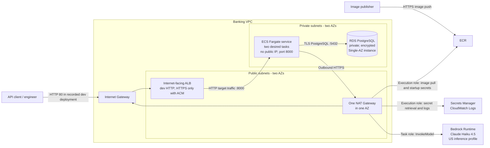

The service spans two AZs for task placement and ALB target distribution, but the development NAT Gateway and RDS instance are single-AZ dependencies. AWS services shown outside the VPC are not deployed into its subnets.

## 4. Architecture components and request flow

| Component | What it does | Why it is used | Recorded development posture |
| --- | --- | --- | --- |
| Application Load Balancer | Accepts client traffic and routes to healthy IP targets | Managed HTTP entry point and target health integration | Public; HTTP listener enabled; HTTPS is conditional on an ACM certificate |
| ECS Fargate | Runs the FastAPI container without managing EC2 hosts | Small containerized service with AWS-managed task placement | Two desired tasks, private subnets, no public IP, port 8000 |
| Amazon ECR | Stores the backend container image | Private registry and image scanning on push | Scan-on-push; task definition uses mutable `:dev` tag |
| RDS PostgreSQL | Stores users, accounts, transactions, and Alembic version state | Managed PostgreSQL rather than self-managed database hosts | Private, encrypted, Single-AZ, gp3 with 20 GB default storage, one-day backup retention |
| Secrets Manager | Supplies DB credentials and JWT secret at task startup | Keeps runtime secrets out of tracked source and images | ECS execution-role reads are scoped to supplied secret ARNs |
| CloudWatch Logs | Receives container stdout/stderr | Supports deployment and runtime troubleshooting | `/ecs/<project>-backend`, seven-day retention |
| Bedrock Runtime | Provides managed model inference for the operations endpoint | Avoids running model-serving infrastructure in this project | Claude Haiku 4.5 through a US cross-region inference profile |
| NAT Gateway | Provides outbound access from private task subnets | Enables private workloads to reach required AWS APIs | One shared NAT Gateway; a cost-saving but reduced-resilience choice |

### Request and dependency flow

1. A client reaches the public ALB through the Internet Gateway. The documented development listener uses HTTP on port 80; an HTTPS listener is created only when an ACM certificate ARN is supplied.
2. The ALB forwards to private ECS IP targets on TCP 8000. Target health checks call `GET /api/health`; the ALB does not connect directly to PostgreSQL.
3. The FastAPI container handles the route and, when needed, opens a TLS PostgreSQL connection to the private RDS endpoint on port 5432.
4. ECS task startup uses the **execution role** for ECR image retrieval, CloudWatch log delivery, and configured Secrets Manager value injection.
5. Running application code uses the separate **task role** for Bedrock `InvokeModel`. The task reaches AWS APIs through outbound HTTPS/NAT; service responses return over those established connections.
6. Security groups constrain ALB-to-task traffic to port 8000 and task-to-RDS traffic to port 5432. The database is not publicly accessible; ECS tasks have no public IP.

Process health and database readiness are intentionally distinct: `/api/health` is a process check, while `/api/ready` tests PostgreSQL with `SELECT 1`.

## 5. Terraform infrastructure implementation

Terraform root configuration composes reusable modules and passes outputs—such as subnet IDs, security-group IDs, secret ARNs, role ARNs, and database endpoint—into dependent components.

| Module | Responsibility |
| --- | --- |
| `terraform/modules/vpc` | VPC, two public/private subnet pairs, Internet Gateway, EIP/NAT Gateway, route tables and associations |
| `terraform/modules/security` | ALB, backend, and database security groups and their permitted flows |
| `terraform/modules/iam` | ECS execution/task roles, startup secret reads, and scoped model invocation |
| `terraform/modules/database` | PostgreSQL RDS instance and private DB subnet group |
| `terraform/modules/compute` | ECR repository, ECS cluster/task/service, CloudWatch log group, ALB/listener/target group |

The modules make component boundaries and dependencies visible; they do not automatically provide environment isolation, remote state, or safe promotion. The provider currently fixes `us-east-1` and a local CLI profile. Development tfvars and state are local and ignored. Only development has deployment evidence. There are no tracked staging/production configurations or deployment records; reusing modules is not the same as having those environments prepared and validated.

The public/private subnets span two AZs. Public route tables use the Internet Gateway; private default routes use one NAT Gateway in the first public AZ. The ALB is public, while ECS and RDS are private. RDS uses a two-AZ subnet group but `multi_az = false`, so the database itself is not Multi-AZ.

The database module encrypts storage, enables RDS-managed master credentials, sets backup retention to one day, and sets `skip_final_snapshot = true`. **Operator note:** retention was reduced to one day following a development-account restriction. The current Terraform value corroborates the resulting setting; no screenshot of the restriction or a prior value is available. This is a development cost/constraint, not a production backup recommendation.

**Terraform evidence.** The first screenshot is a safe crop of the RDS subnet-group permission failure; the following evidence shows a policy attachment and a later apply summary. The exact deployer policy is external to this repository.


*Terraform reported an access-denied failure for `rds:CreateDBSubnetGroup`; related IAM policy-write denial is documented in the incident report.*

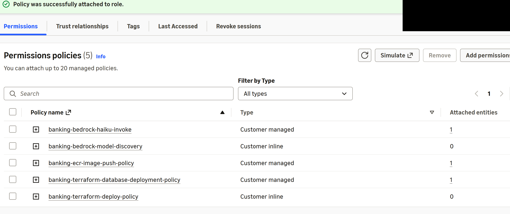

*IAM console records successful attachment of the updated deployment policy; the policy document is not shown.*

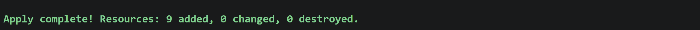

*Apply summary records nine additions and no changes or destroys; sensitive outputs are excluded.*

The KMS permission troubleshooting and the scope of the operator correction are described under [KMS incident response](#kms-permission-failure).

## 6. FastAPI backend and PostgreSQL implementation

The Python 3.12 FastAPI application registers routes under `/api`. Pydantic validates request shapes; SQLAlchemy maps PostgreSQL models; Alembic applies explicit schema revisions.

| Route | Authentication | Behavior |
| --- | --- | --- |
| `GET /api/health` | Public | Process health only |
| `GET /api/ready` | Public | PostgreSQL readiness via `SELECT 1`; returns 503 when unavailable |
| `POST /api/users/register` | Public | Registers a user and stores a password hash |
| `POST /api/users/login` | Public | Verifies credentials and returns a bearer JWT |
| `GET, POST /api/accounts` | JWT | Lists the current user's accounts / creates a zero-balance account |
| `POST /api/transactions` | JWT | Records an owned-account withdrawal with a row lock; deposits are rejected until a trusted funding source exists |
| `POST /api/ops/analyze` | JWT | Requests read-only operational analysis from Bedrock |

The project models `users`, `accounts`, and `transactions`. Database settings support a `DATABASE_URL` or discrete `DB_*` values. The application uses SQLAlchemy `URL.create` for discrete credentials rather than manual URL interpolation. The Alembic environment explicitly renders a SQLAlchemy URL with `hide_password=False` and doubles percent signs before Alembic config interpolation. The historical reason for that migration-specific treatment is detailed in the operator notes below.

For RDS, the ECS container points to the public AWS CA bundle at `backend/certs/global-bundle.pem` and configures certificate verification. Keep this bundle: it is public trust material, not a private key. Migrations are run explicitly in a standalone private ECS task rather than automatically at each API startup.

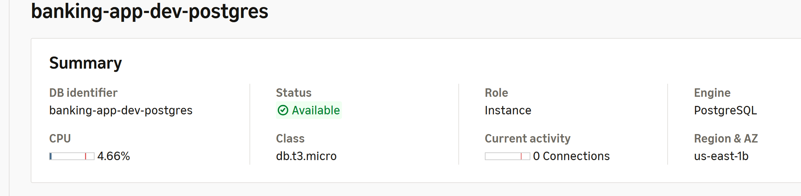

*RDS console snapshot shows the development PostgreSQL instance as Available; this is historical status evidence.*

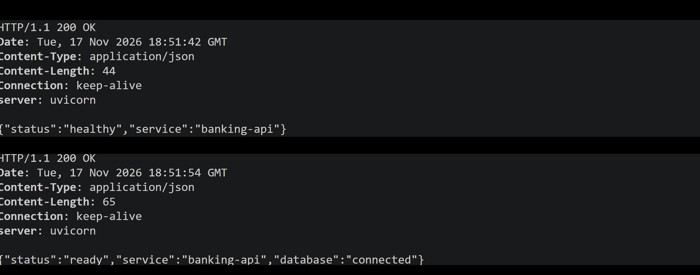

*The readiness response reports PostgreSQL connected, alongside successful health/readiness checks.*

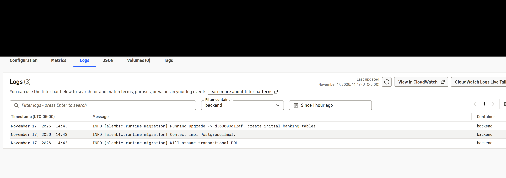

*CloudWatch task output records the Alembic upgrade; the screenshot does not expose database credentials.*

## 7. Docker, ECR, and ECS Fargate deployment

The backend Docker image runs as non-root UID 10001, exposes port 8000, and includes the RDS CA bundle. Terraform provisions an ECR repository with scan-on-push enabled and an ECS Fargate task definition with `awsvpc` networking, 256 CPU units, and 512 MiB memory.

The ECS service uses private subnets, no public IP, a desired count of two, a 60-second health-check grace period, and a deployment circuit breaker with rollback enabled. The ALB target group uses IP targets and checks `/api/health` on port 8000 every 30 seconds with a five-second timeout and 2/3 healthy/unhealthy thresholds. ECR tags are mutable and the task definition references `:dev`; a push to that tag alone does not pin a release digest or necessarily force a new deployment.

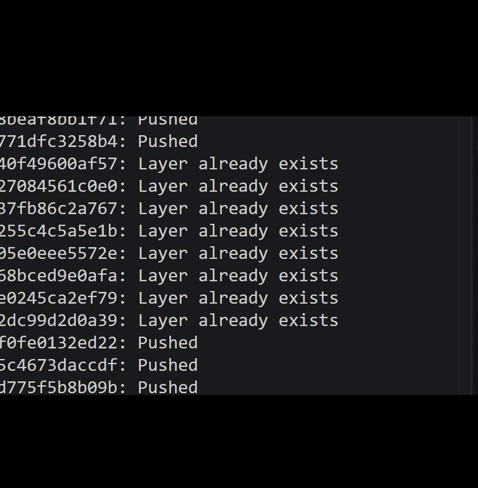

*Docker/ECR output records image-layer uploads; repository URI and digest are deliberately omitted.*

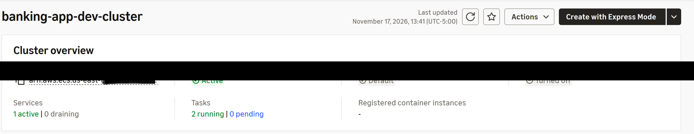

*ECS cluster snapshot records an active service, two running tasks, and no pending tasks at that point in time.*

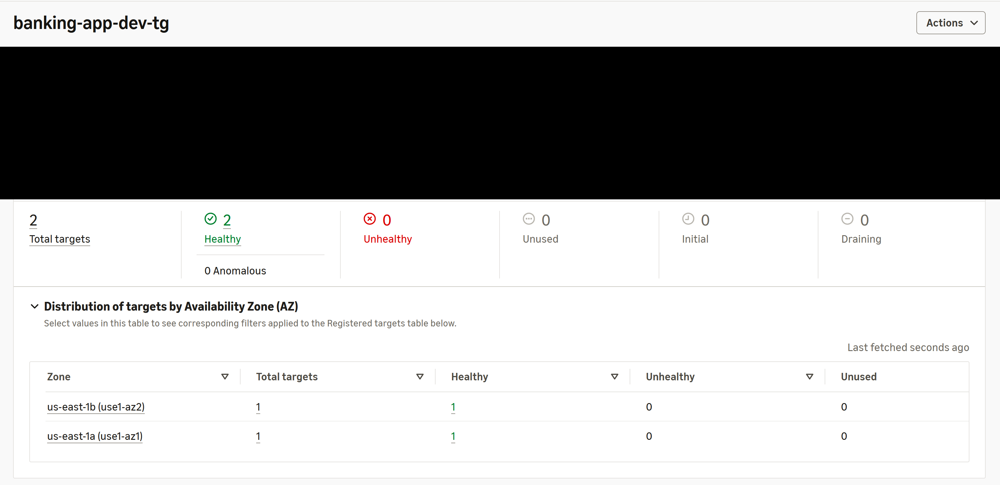

*Target-group evidence shows two healthy IP targets distributed across two AZs.*

The running-task screenshot is a historical point-in-time view. It is not a continuous availability measurement or evidence that the service is still deployed.

## 8. IAM, networking, authentication, and security

### Network boundaries

- ALB ingress is public. The recorded development listener is HTTP; the security-group module's 443 rule does not mean an HTTPS listener or certificate was deployed.
- The ALB sends TCP 8000 only to the backend security group.
- Private ECS tasks have no public IP. Their security group can connect to PostgreSQL on TCP 5432.
- RDS ingress is from the backend security group rather than arbitrary client CIDRs.
- Private task egress to AWS APIs uses the shared NAT Gateway over HTTPS. This is a single-AZ egress dependency and can incur cross-AZ traffic.

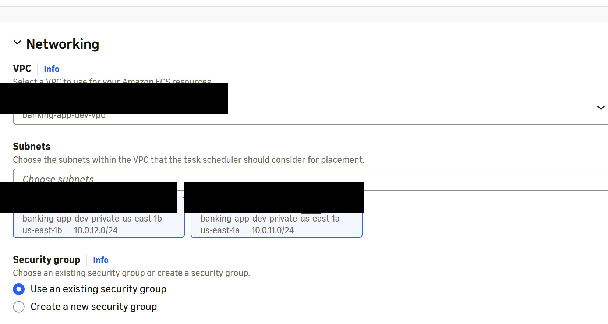

*The migration task was configured in private subnets; the screenshot does not prove which SG was selected.*

### Workload identities

| Identity | Source-configured responsibility |
| --- | --- |
| ECS execution role | ECR image pull, CloudWatch log delivery, and `secretsmanager:GetSecretValue` for configured DB/JWT secret ARNs |
| ECS application task role | Scoped `bedrock:InvokeModel` for the configured US inference profile and associated regional foundation-model resources |
| Terraform deployer | Provisions infrastructure; its effective policy is external to this repository |
| Image publisher | Separate identity pushes to ECR; no publisher keys are embedded in the application |

**Operator note:** Bedrock invocation belongs on the application task role. Startup-time secret retrieval belongs on the execution role. These are different ECS identities and should not be exchanged. The model itself receives no AWS credentials, tools, or infrastructure mutation capability.

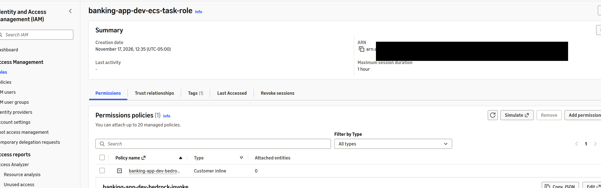

*The console confirms an application task-role policy attachment, but not its effective statements or boundaries.*

### Application authentication and data handling

Passwords are hashed with `pwdlib.PasswordHash.recommended()`. JWTs use HS256 with a 30-minute expiration; account, transaction, and AI operations require a bearer token. No application-user MFA, token revocation list, or production session lifecycle is evidenced.

The public development ALB uses HTTP, so credentials and data sent through it lack transport encryption. Do not send real customer information, balances, or authentication material through this deployment. The RDS TLS setup uses the bundled CA for server verification in ECS; the local database helper's fallback `sslmode=require` does not verify server identity.

The AI input/output checks are deliberately limited, defense-in-depth patterns—not a complete DLP or prompt-injection boundary. Details and tests are in the [AI section](#9-amazon-bedrock-and-claude-ai-integration) and [security design](docs/security-design.md).

## 9. Amazon Bedrock and Claude AI integration

`POST /api/ops/analyze` is a JWT-protected advisory endpoint for an engineer describing an operational symptom. The service uses Boto3's Bedrock Runtime **Converse API** with Claude Haiku 4.5 through the US cross-region profile:

```text
us.anthropic.claude-haiku-4-5-20251001-v1:0
```

The service separates system instructions from user content, JSON-serializes and labels the description as untrusted operational text, and asks for safe read-only troubleshooting. Selected patterns reject likely AWS access keys, bearer tokens, and password assignments. Output checks reject selected sensitive patterns and certain explicit destructive claims. Provider or output-validation failures return a controlled HTTP 502 and are logged.

These controls do **not** fully prevent prompt injection, data leakage, hallucination, or unsafe advice. The assistant does not independently inspect AWS state, execute commands, or modify resources. Engineers must validate recommendations using authoritative logs and reviewed change procedures.


*A protected API request returned model-generated analysis; the advice is not verified infrastructure state.*

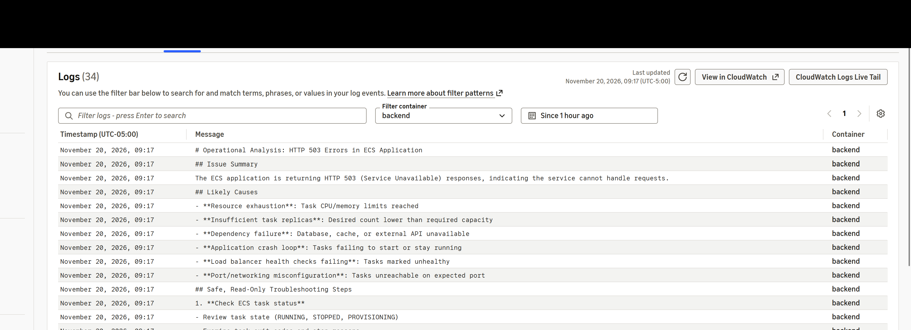

*Later task logs show an analysis response following the permission troubleshooting sequence.*

The application task role—not the execution role—authorizes model invocation. The Terraform policy grants `bedrock:InvokeModel` to the inference profile and associated regional foundation-model resources; it does not grant general Bedrock administration or infrastructure changes.

## 10. Deployment validation

The repository and screenshots support these historical checkpoints:

| Date/phase | Recorded validation |
| --- | --- |
| October 30, 2026 — Stage 1 | Initial infrastructure rollout, ECS/ALB checks, and two healthy targets; the environment was later torn down while ECR was preserved |
| November 17, 2026 — Stage 2 | Private PostgreSQL deployment, Alembic revision `d368608d12af`, schema/readiness checks, private-task Bedrock inference, and AI API status checks |
| November 18, 2026 | Deliberate ALB 503 break/fix exercise followed by health and readiness HTTP 200 |
| November 20, 2026 | ECS startup, role-permission troubleshooting, and AI authentication/input validation screenshots |


*This point-in-time target-group view shows two healthy targets in separate Availability Zones.*


*The recorded readiness result reports database connectivity; it is not a continuous availability measurement.*

The project record reports 19 local Pytest tests passing during the prior documentation update. Those tests use local SQLite/synthetic secrets and do not validate AWS IAM, public HTTPS, production resilience, real-money workflows, or regulatory controls. This documentation change does not alter application or infrastructure code and did not query AWS. No current live resource status is claimed.

## 11. Detailed troubleshooting and incident response

The cases below distinguish deployment/runtime failures from controlled break/fix exercises. Each incident's business impact is potential only; no real customer impact or outage duration is inferred. Recommended commands use placeholders and do not print credentials or secret values.

### AWS MFA, STS, and Terraform deployment permissions

**Problem:** An STS role-assumption request returned `InvalidClientTokenId`; a separate MFA recovery command was denied `iam:ListMFADevices`. Terraform also encountered denied `rds:CreateDBSubnetGroup` and `iam:PutRolePolicy` operations. Credential validity and IAM authorization were distinct blockers.

**Failure evidence:**


*The redacted terminal excerpt records `InvalidClientTokenId` during STS role assumption.*


*The cropped Terraform error identifies the denied RDS subnet-group operation without account or request IDs.*

**Investigation:** Confirm the selected profile/source profile and region, then verify the caller identity with fresh approved credentials. For each denial, inspect action, resource, principal, boundary, trust policy, SCP, and any resource policy. Useful read-only checks include:

```powershell
aws sts get-caller-identity --profile <mfa-session-profile>
aws configure list --profile <mfa-session-profile>
terraform plan
```

**Root cause:** The invalid-token response proves the submitted session was unusable, but does not establish whether it expired, was malformed, or came from the wrong profile. The permission errors show that the deployment identity lacked authorization for the denied Terraform operations; the external effective policy delta is not stored in this repository.

**Resolution:** The evidence sequence records a later MFA-backed role identity, an operator policy update, and a subsequent successful Terraform apply. It does not establish a broad administrator grant or preserve the exact external policy statement.

**Why the fix worked:** Refreshing an approved MFA-backed session addresses credential validity. Granting only the provisioning actions required by the reviewed plan addresses authorization. Neither change substitutes for the other.

**Recovery evidence:**


*Caller-identity output includes the assumed deployment-role name; account and session details are masked.*


*The IAM console records the deployment policy attachment succeeding.*


*A later apply summary records nine resources added after the permission/session troubleshooting sequence.*

**Business impact:** A blocked deployment or repair can delay a planned release or recovery. No customer outage or financial impact is evidenced.

**Prevention:** Use approved short-lived federation/MFA credentials, verify caller identity before Terraform, keep a reviewed least-privilege deployer policy, inspect plans after partial applies, and never capture tokens or authorization details in shared logs.

### KMS permission failure

**Problem:** A deployment-role `kms:DescribeKey` request was denied during development infrastructure troubleshooting.

**Failure evidence:**

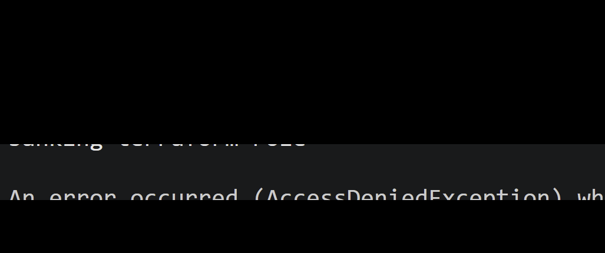

*The cropped terminal excerpt retains the access-denied context while omitting profile/account identifiers.*

**Investigation:** Check the exact principal, key, region, denied action, IAM policy, key policy, permissions boundary, and organization controls. Distinguish metadata access from cryptographic use.

**Root cause:** **Operator note:** the deployment identity lacked the required `kms:DescribeKey` permission. The screenshot sequence supports a DescribeKey denial, but does not expose a complete effective policy document.

**Resolution:** **Operator note:** the correction added scoped `kms:DescribeKey` permission rather than unrestricted KMS access. A later policy summary shows limited KMS read, and a key-state query reported `Enabled`.

**Why the fix worked:** `DescribeKey` allows key metadata inspection; it does not grant decrypt, key administration, or broad cryptographic use. Effective behavior still depends on the key policy and other AWS policy layers.

**Recovery evidence:**

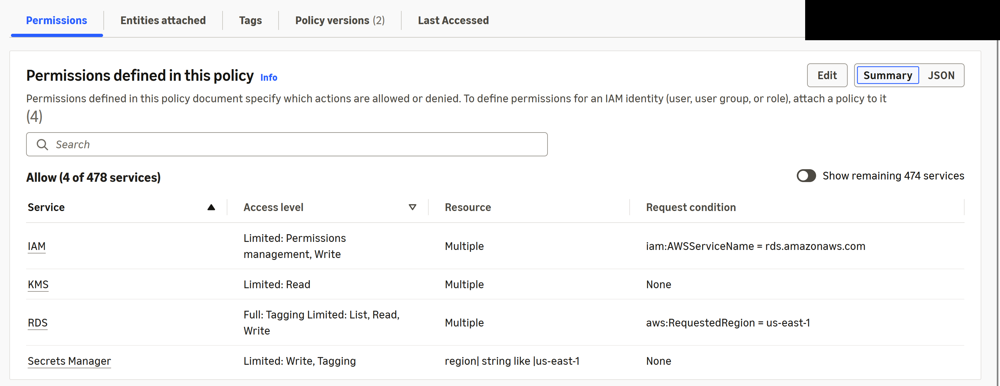

*The IAM summary displays limited KMS read access; it does not prove the exact `kms:DescribeKey` statement.*

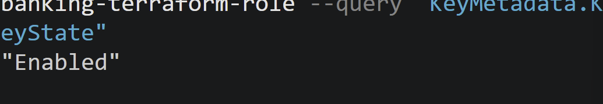

*A later metadata query reports the key as Enabled, not an end-to-end RDS recovery.*

This is partial validation only; an enabled key does not prove that the database operation or RDS connectivity succeeded.

**Business impact:** Missing metadata permissions can block authorized provisioning or diagnosis of encrypted resources. No data loss, database outage, or customer impact is established.

**Prevention:** Grant the minimum action/resource needed; review IAM and key policies together; verify with a scoped operation; and test RDS provisioning/connectivity separately from metadata lookup.

### ALB HTTP 503 and target draining

**Problem:** The development ALB returned HTTP 503 while the target group had no healthy backend capacity and targets were draining.

**Failure evidence:**

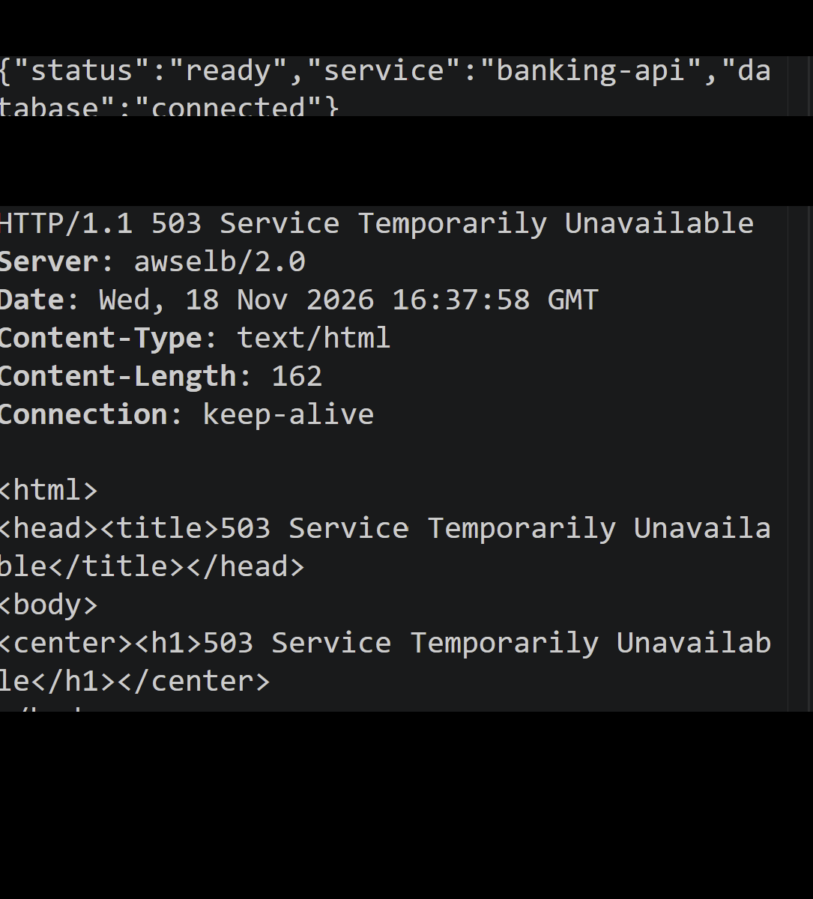

*The development endpoint returned an ALB-generated 503 while no healthy target capacity was available.*

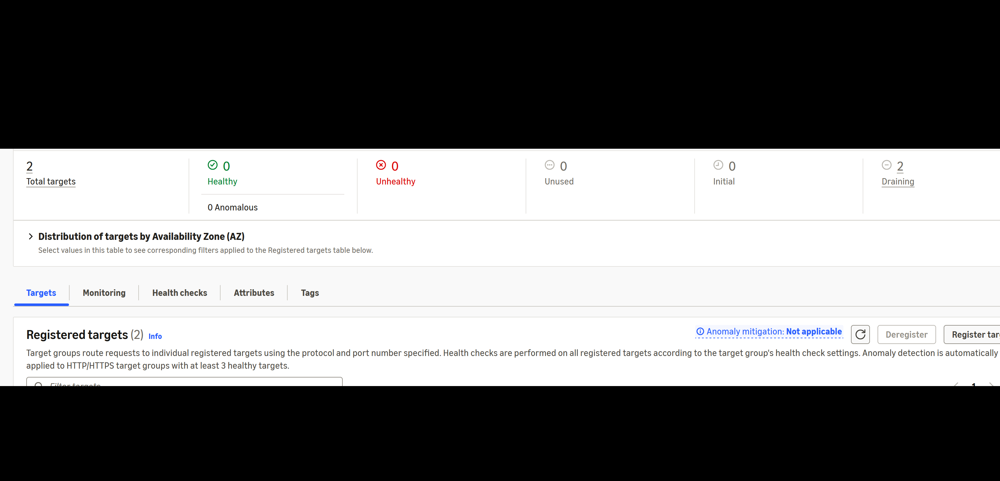

*The target-group view records draining targets and no healthy targets during the controlled exercise.*

**Investigation:** Check ECS desired/running/pending counts and service events, target registration and health reason codes, listener/rule/target port, task stop reasons, and CloudWatch startup logs. Example read-only checks:

```powershell
aws ecs describe-services --cluster <cluster> --services <service>
aws elbv2 describe-target-health --target-group-arn <target-group-arn>
curl -i http://<development-alb>/api/health
curl -i http://<development-alb>/api/ready
```

**Root cause:** **Operator note:** this was a deliberate break/fix exercise in which ECS was scaled to zero tasks to simulate unavailable backend capacity. The zero-capacity condition explains why the ALB could not route to a healthy task. It was not a documented customer outage.

**Resolution:** **Operator note:** service capacity was restored. The screenshots do not independently show the scale change; the restoration note is operator-provided.

**Why the fix worked:** The ALB can route only after ECS tasks start, register as IP targets, pass health checks, and become healthy. Restoring task capacity enabled that sequence.

**Recovery evidence:**

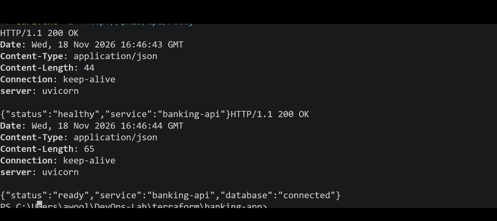

*Recorded checks later returned HTTP 200; readiness reported the database connected.*

The recorded readiness response reports the database connected. This is a point-in-time check, not an uptime or recovery-time measurement.

**Business impact:** A real 503 could make account, authentication, and transaction endpoints unavailable. No real user impact, transaction impact, or outage duration is evidenced.

**Prevention:** Alert on desired-versus-running count, deployment events, target health, and ALB 5xx; preserve deployment/health reason codes; test circuit-breaker rollback; and verify both process health and database readiness after a release.

### ECS startup failure

**Problem:** An ECS container failed before serving traffic because Uvicorn could not import its configured ASGI target.

**Failure evidence:**

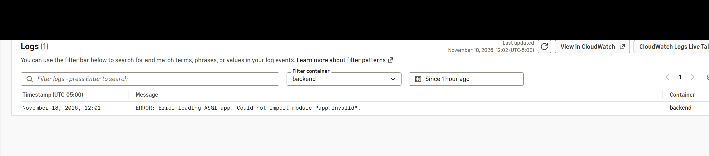

*The startup log reports that Uvicorn could not import `app.invalid`.*

**Investigation:** Inspect stopped-task reason and exit code, task-definition command, image digest, required environment/secrets, Uvicorn bind address and port, health path, resource limits, deployment events, and CloudWatch startup logs. Example:

```powershell
aws ecs describe-tasks --cluster <cluster> --tasks <task-arn>
aws logs tail /ecs/<project>-backend --since 30m
```

**Root cause:** The failing log explicitly reports `Could not import module "app.invalid"`. That invalid import target is the immediate cause; the evidence does not show how it entered the task definition/image.

**Resolution:** The exact corrective change is not recorded. A later log shows the application process starting, but the screenshots do not prove that it is the same task definition or deployment.

**Why the fix worked:** Uvicorn needs an importable ASGI target. A later successful process startup demonstrates that a valid process could start, not which setting was changed.

**Recovery evidence:**

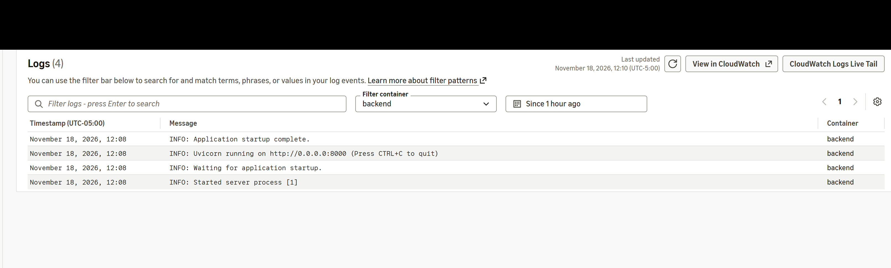

*A later, not demonstrably correlated task log records successful process startup on port 8000.*

This does not establish ALB target health or database readiness for the same rollout.

**Business impact:** Failed essential containers can reduce service capacity or prevent the API from serving requests. No real customer impact or outage duration is evidenced.

**Prevention:** Test the built image and task command in CI; validate imports/configuration before release; retain task-definition revisions and image digests; and check target health/readiness after startup.

### PostgreSQL authentication and Alembic migration

**Problem:** A migration attempt received a PostgreSQL password-authentication failure for `bankadmin`. A later migration completed successfully.

**Failure evidence:**

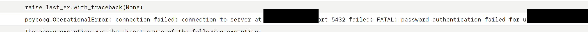

*The migration log records PostgreSQL password authentication failure; the private host is masked.*

**Investigation:** Verify the migration task's DB host/name, secret version and field mapping, execution-role secret retrieval, password handling, TLS CA configuration, and task network. Avoid printing the URL or secret. Test reserved characters without logging credential values.

**Root cause:** **Operator note:** an earlier Alembic implementation converted a SQLAlchemy URL object with `str(database_url)`, which masked the password. The migration configuration was corrected to call `render_as_string(hide_password=False)` and escape percent signs with `replace("%", "%%")` before `set_main_option`. The current [`env.py`](backend/migrations/env.py) contains that handling. Git history first tracks the corrected form in the initial migration-environment commit; it does not preserve the earlier local version, so the historical `str()` detail remains an operator note.

**Resolution:** **Operator note:** after correcting URL rendering/percent escaping, the Docker image was rebuilt and pushed. The source screenshot confirms ECR layers were pushed, and a later ECS task log records an Alembic revision upgrade.

**Why the fix worked:** SQLAlchemy's string representation hides passwords by default. Alembic needs an unmasked URL to connect, while its config parser treats `%` as interpolation syntax; explicit rendering followed by percent escaping preserves the intended credential through both steps.

**Recovery evidence:**


*The rebuilt image's layers were pushed to ECR; registry and digest identifiers are withheld.*


*A subsequent task log records the Alembic revision upgrade.*

**Business impact:** A blocked migration can delay a release or prevent a database-backed API from starting against the intended schema. No data loss or customer impact is evidenced.

**Prevention:** Use structured URL creation/rendering; keep secret values out of logs; test percent/reserved characters; pin the image digest and task-definition revision; and verify the migration head before enabling traffic.

### RDS security-group connectivity failure

**Problem:** A standalone migration task timed out connecting to PostgreSQL. A separate November 19 application log reports that the database connection closed unexpectedly; those are not assumed to be the same event.

**Failure evidence:**

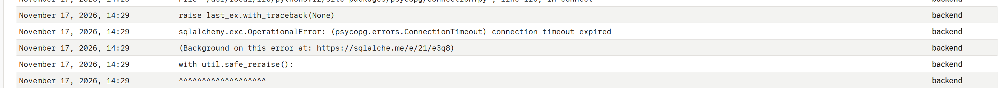

*The task log reports a connection timeout, a network symptom distinct from authentication failure.*

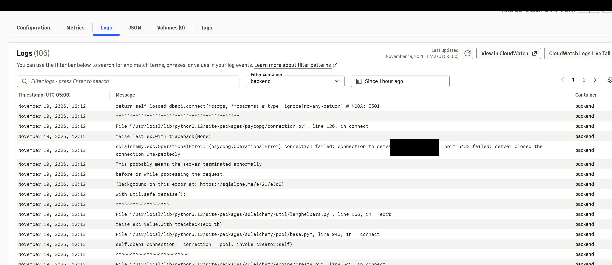

*This separate November 19 log reports a connection close; its cause is not established by the screenshot.*

**Investigation:** Compare the migration task's VPC, private subnet, ENI, and backend security group with the RDS security group ingress source and TCP 5432 rule. Check RDS status/events, route tables, DNS, TLS, and PostgreSQL logs. Useful read-only checks:

```powershell
aws ecs describe-tasks --cluster <cluster> --tasks <task-arn>
aws ec2 describe-security-groups --group-ids <backend-sg-id> <database-sg-id>
aws rds describe-db-instances --db-instance-identifier <db-identifier>
```

**Root cause:** **Operator note:** the timed-out migration task was launched without the intended backend security group. The task was relaunched with the correct group and the migration succeeded. The private-subnet screenshot does not show the selected security-group value, so that part of the root cause comes from the operator note. The separate November 19 connection-closed event's cause remains unknown.

**Resolution:** The migration task was relaunched with the backend security group. No specific fix is verified for the separate connection-closed event; a screenshot named as connectivity restored is not a same-task readiness proof.

**Why the fix worked:** RDS accepts PostgreSQL traffic from the backend security group on TCP 5432. A task missing that group cannot use the intended network path; attaching it restores the permitted source identity without opening PostgreSQL to public CIDRs.

**Recovery evidence:**


*The task configuration shows private subnet placement, but not the selected security group.*


*A later migration completed after the operator-reported relaunch; this does not resolve the separate connection-close event.*

The later migration supports recovery of that migration attempt; it does not close the separate November 19 connection event.

**Business impact:** Database reachability failures can block schema changes and database-backed API operations. No customer impact, data loss, or outage duration is evidenced.

**Prevention:** Allow only backend-SG-to-database-SG TCP 5432; verify the standalone task's network configuration before launch; correlate task and RDS events; and validate readiness from the same release after a network change.

### Secrets Manager access denial

**Problem:** ECS startup failed while retrieving a configured secret; the error identifies `secretsmanager:GetSecretValue` as denied for the task execution role.

**Failure evidence:**

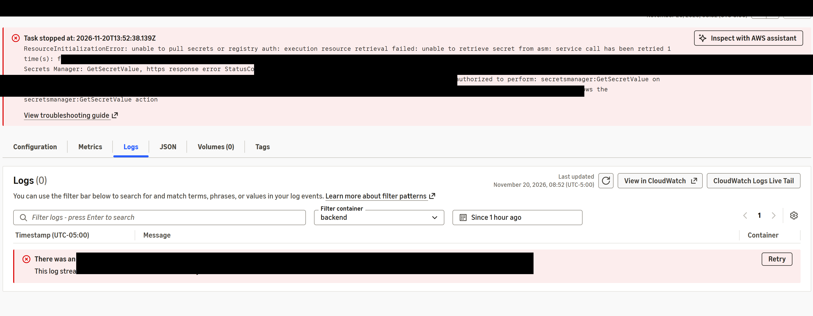

*The ECS initialization error records secret retrieval denial; identifying ARNs and task IDs are masked.*

**Investigation:** Identify the execution role on the task definition, exact secret ARN/region, `GetSecretValue` permission, role trust, secret JSON key mapping, and KMS key policy if a customer-managed key is used. Do not inspect by printing secret values.

**Root cause:** The captured test execution role had no identity-based permission for the requested secret read. **Operator note:** startup-time Secrets Manager access belongs to the ECS execution role, not the application task role. Terraform source grants `GetSecretValue` for configured DB/JWT secret ARNs on the execution role.

**Resolution:** The repository contains the intended scoped execution-role grants. The screenshot sequence does not preserve the exact live policy change or prove it was applied to the same test role/task.

**Why the fix worked:** ECS retrieves task-definition secrets before the container starts using the execution role. A task-role permission cannot satisfy this startup retrieval.

**Recovery evidence:**

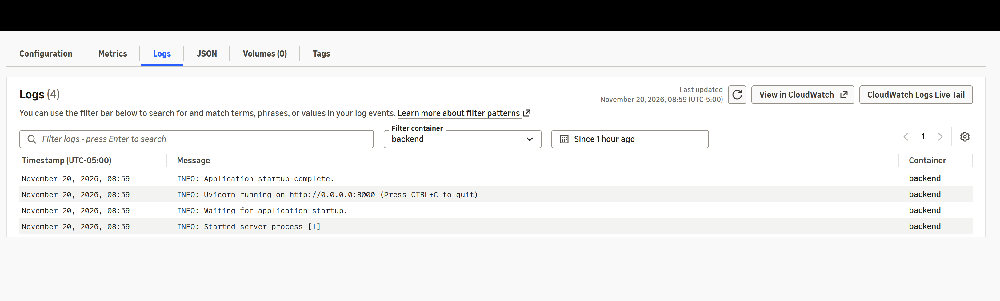

*A later task started successfully, but the screenshot is not correlated to the denied test role/task.*

This is later startup evidence only; it is not correlated to the denied test role and is not marked as a confirmed same-task recovery.

**Business impact:** Tasks missing required database/JWT secrets can fail initialization or remain unable to serve authenticated/database-backed requests. No user impact is evidenced.

**Prevention:** Keep execution-role and task-role responsibilities explicit; scope secret reads to required ARNs; check secret field names and KMS policies; and validate task startup plus `/api/ready` on the same release.

### Bedrock task-role permission failure

**Problem:** A test ECS application task received `AccessDeniedException` for `bedrock:InvokeModel`.

**Failure evidence:**

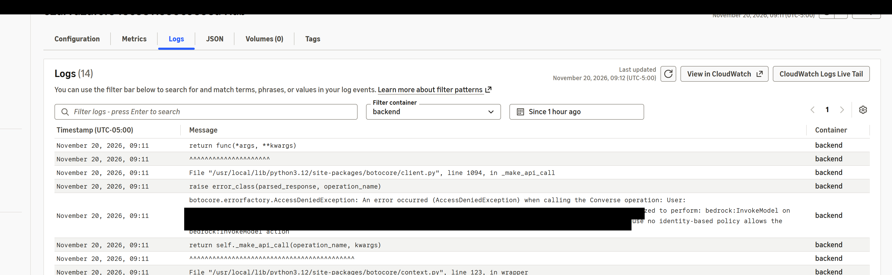

*CloudWatch records `AccessDeniedException` for `bedrock:InvokeModel`; principal and resource identifiers are redacted.*

**Investigation:** Verify the task role attached to the running task, denied action/resource, selected inference-profile and destination model ARNs, region/account model access, and policy layers. Do not grant `bedrock:*` or administrator permissions as a shortcut.

**Root cause:** The isolated test task role lacked the required invocation permission. **Operator note:** invocation permission belongs on the ECS application task role; Secrets Manager startup retrieval belongs on the execution role. Terraform source attaches scoped `bedrock:InvokeModel` to the application role for the US profile and associated regional model resources.

**Resolution:** The application task role is configured with the scoped invoke permission in Terraform. The live policy delta is not captured as a separate change event.

**Why the fix worked:** Bedrock authorizes the runtime call against the task's effective identity and the inference-profile/model resources. A scoped allow can permit the call when model access, resource policies, quotas, and organization controls also permit it.

**Recovery evidence:**


*A later task log contains a model-generated operations analysis, not verified AWS state.*


*The endpoint later returned an authenticated response; this does not prove current availability.*

These are later successful behavior snapshots; they do not establish current service state or prove that the isolated test role's policy was changed in place.

**Business impact:** Bedrock denial can disable the advisory endpoint but does not by itself block core account or transaction routes. No customer impact is evidenced.

**Prevention:** Keep invocation on the task role; scope actions/resources to the configured profile and regional models; test using the service's actual task identity; and monitor provider failures and inference spend.

### AI authentication, sensitive-input, and prompt-injection checks

The recorded validation sequence returned 401 for missing/invalid JWTs, 400 for a selected sensitive-input pattern, and 200 for an authenticated prompt-injection test request. The screenshot shows statuses, not the prompt-injection response body. A 200 proves only that a response was returned—not that the injection was blocked.

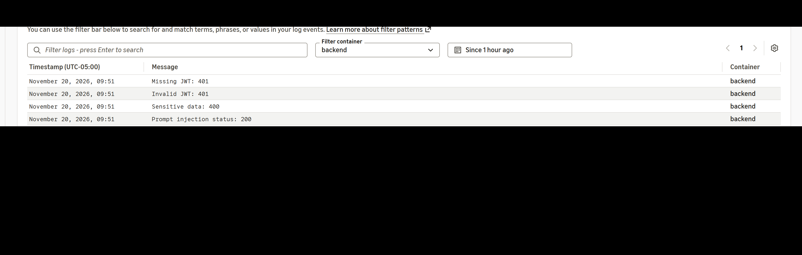

*Recorded statuses include 401 authentication failures, a selected-input 400, and an injection-test 200; the 200 response body is not shown.*

The local source tests exercise JWT authorization and selected input/output checks. Regex matching, JSON serialization, and system-prompt wording can reduce risk but cannot guarantee prompt-injection resistance or prevent data leakage. Do not submit customer data, balances, credentials, JWTs, or confidential incident details.

The incident index and detailed reports retain evidence gaps and operator notes: [troubleshooting index](docs/troubleshooting.md), [incident reports](docs/incidents/), [screenshot inventory](docs/screenshots/README.md).

## 12. Engineering decisions and tradeoffs

| Decision | Current choice and business rationale | Limitation | When another choice is appropriate |
| --- | --- | --- | --- |
| ECS Fargate vs EC2/Kubernetes | Fargate removes host patching and cluster operations for a small demo | Higher unit cost at steady utilization; limited host control | EC2 can fit predictable high utilization or specialized hosts; Kubernetes can fit a larger platform when its ecosystem and operational expertise justify complexity |
| RDS vs self-managed PostgreSQL | Managed backups/patching/monitoring reduce database operations for the portfolio | Managed-service constraints; current DB is Single-AZ, one-day retention, and app uses the master credential | Self-management only when extension/control/economics justify owning HA, patching, backups, restores, and on-call |
| One NAT vs per-AZ NAT | One shared NAT lowers fixed development expense | Single-AZ egress dependency and possible cross-AZ transfer cost | Per-AZ NAT for AZ-local resilience, or supported VPC endpoints when their cost and service coverage fit |
| Single-AZ vs Multi-AZ RDS | Single-AZ reduces demo cost for disposable data | No automatic standby failover; current final-snapshot behavior is unsuitable for durable data | Multi-AZ plus tested backups/restores when business recovery objectives require them; Multi-AZ is not a backup strategy |
| Public ALB vs private application workloads | Public ALB is convenient for API demonstration while ECS/RDS remain private | Development listener is HTTP and publicly exposed | Use ACM-backed HTTPS, WAF/rate limits, or private ALB/VPN/PrivateLink for internal-only services |
| Secrets Manager vs hardcoded credentials | Secret injection avoids committing credentials and centralizes access | Requires correct execution-role/KMS access; rotation is unverified and app receives the RDS master credential | Add rotation and a least-privilege application DB role; use another approved secret system only with equivalent controls |
| IAM task roles vs static keys | ECS task credentials are short-lived and scoped; app needs no static AWS keys | Role separation and effective permissions still require review | Use federation/assume-role for humans and CI; avoid static workload keys |
| Managed Bedrock vs self-hosted model | Managed inference avoids GPU/model-serving operations and integrates with Boto3 | Provider/model availability, region, quotas, data governance, behavior, and token cost | Self-host only when control, residency, latency, or economics justify model-serving and patching responsibilities |
| Read-only AI vs autonomous agent | Advisory output can help an engineer without model-driven infrastructure changes | No direct telemetry tools; recommendations need human verification; prompt controls are incomplete | Consider only deterministic, allowlisted, reversible runbooks with policy checks, approval, audit, idempotency, and failure testing |
| Development cost vs production resilience | Small tasks/DB, one NAT, short log retention, and mutable `:dev` reduce demo complexity | Reduced resilience, observability, retention, and release integrity | Increase redundancy, backups, alarms, immutable releases, and operational coverage to match business risk |

## 13. Production improvements

Before any real financial workload, the design would need a new requirements, threat-model, and compliance review. Prioritized engineering work includes:

1. **Protect public traffic:** ACM-backed HTTPS, HTTP redirect/rejection, WAF/rate limits, secure cookie/token policy, and no credentials over plaintext.
2. **Implement financial correctness:** double-entry ledger, funded deposit/payment flows, idempotency, reconciliation, authorization rules, audit events, fraud/risk controls, and domain-level invariants.
3. **Strengthen identity and data access:** application-user MFA and lifecycle, token rotation/revocation, least-privilege DB role, secret rotation, data classification, and privacy controls.
4. **Improve resilience:** Multi-AZ database where justified, per-AZ egress or appropriate VPC endpoints, durable final-snapshot/backup policy, tested restore/failover, and explicit RPO/RTO.
5. **Harden delivery:** encrypted remote Terraform state with locking, separated accounts/roles per environment, immutable image digests, CI/CD with short-lived credentials, and security gates.
6. **Operate the service:** metrics, alarms, tracing, structured/minimized logs, runbooks, ECS scaling, deployment verification, and tested incident response.
7. **Evaluate AI safely:** minimize submitted context, rate-limit and budget inference, strengthen adversarial evaluations, use structured outputs where useful, and require human review. Do not grant a general-purpose AWS role to a model.

The current one-day RDS backup retention and `skip_final_snapshot = true` are especially unsuitable for durable production data.

## 14. Project accomplishments

The project demonstrates the ability to connect application requirements to AWS infrastructure, implement a private containerized service and PostgreSQL migrations, reason about task/execution roles and security-group paths, integrate managed AI with bounded permissions, and document failures without overstating their causes or outcomes.

### Repository structure

```text
banking-app/
├── backend/
│   ├── app/                  # FastAPI routes, models, auth, database, AI service
│   ├── migrations/           # Alembic schema history
│   ├── tests/                # Pytest suite
│   ├── certs/                # Public RDS CA bundle
│   └── Dockerfile
├── terraform/
│   ├── modules/              # VPC, security, IAM, database, compute
│   └── environments/         # Local ignored development values only
├── docs/
│   ├── incidents/            # Evidence-based reports
│   └── screenshots/
│       ├── evidence/         # Reviewed publication derivatives
│       └── banking-appdocsscreenshots/  # Original intake; ignored by Git
└── README.md
```

### Documentation navigation

- [Architecture and infrastructure](docs/architecture.md)
- [Security design](docs/security-design.md)
- [AI operations](docs/ai-operations.md)
- [Engineering tradeoffs](docs/engineering-tradeoffs.md)
- [Troubleshooting index](docs/troubleshooting.md)
- [Detailed incident reports](docs/incidents/)
- [Screenshot inventory and evidence provenance](docs/screenshots/README.md)
- [Publication and sensitive-data review](docs/publication-review.md)
- [Backend setup and tests](backend/README.md)

The original screenshots remain unmodified in the ignored intake directory; only reviewed derivatives are intended for publication. The repository excludes Terraform state/plan files, `.tfvars`, `.env`, private keys, credentials, local databases, and the original screenshot directory. Review the complete diff before publishing; do not commit or push secrets or unredacted evidence.
