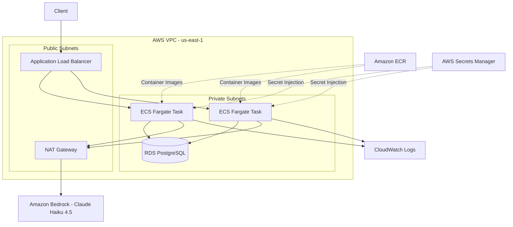
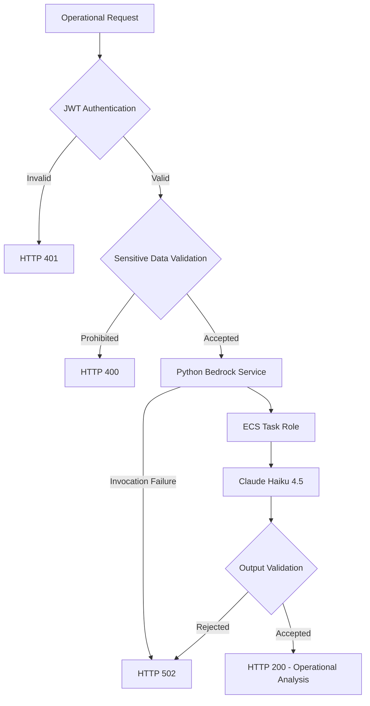

# Cloud-Native Banking Application | Terraform, FastAPI & Amazon Bedrock

A cloud-native banking application combining modular AWS infrastructure, containerized backend services, PostgreSQL database integration, and a security-focused generative AI operations assistant.

This project demonstrates practical experience in Cloud Engineering, DevOps, AI Platform Engineering, Infrastructure as Code, backend development, and AI security.

## Project Status

**Stage 2 successfully deployed and validated on November 17, 2026.**

The application has progressed from an initial infrastructure deployment to a database-integrated banking backend with authenticated API endpoints and live Amazon Bedrock inference.

This is a development and engineering portfolio project, not a production-ready financial platform.

## Technology Stack

| Category | Technologies |
| --- | --- |
| Cloud | Amazon Web Services |
| Infrastructure as Code | Terraform |
| Containerization | Docker |
| Container Orchestration | Amazon ECS Fargate |
| Backend | Python, FastAPI, Uvicorn |
| Database | Amazon RDS PostgreSQL |
| Database ORM | SQLAlchemy |
| Database Migrations | Alembic |
| Artificial Intelligence | Amazon Bedrock, Claude Haiku 4.5 |
| AWS SDK | Boto3 |
| Authentication | JWT, HS256 |
| Password Security | Argon2 |
| Secrets Management | AWS Secrets Manager |
| Monitoring | Amazon CloudWatch |
| Container Registry | Amazon ECR |
| Testing | Pytest |

## Architecture



### Infrastructure Design

- VPC with public and private subnets across two Availability Zones.
- Public Application Load Balancer distributing requests to private ECS Fargate tasks.
- ECS service configured with two desired backend tasks.
- Private container networking without public IP addresses.
- Shared NAT Gateway providing outbound connectivity.
- Encrypted PostgreSQL database hosted on Amazon RDS.
- Security group references restricting traffic between application components.
- Amazon ECR with image scanning on push.
- Separate ECS execution and application task roles.
- CloudWatch container logging with seven-day retention.

## Terraform Module Structure

The infrastructure uses reusable Terraform modules with environment-specific configuration.

| Module | Responsibility |
| --- | --- |
| `vpc` | VPC, subnets, route tables, Internet Gateway and NAT Gateway |
| `security` | Load balancer, backend and database security groups |
| `compute` | ECS cluster, task definition, service, ALB, ECR and logging |
| `database` | RDS PostgreSQL and database subnet group |
| `iam` | Execution roles, application roles and scoped access policies |

### Infrastructure Validation

Following infrastructure deployment and the addition of Bedrock runtime permissions, a complete Terraform plan returned:

```text
No changes. Your infrastructure matches the configuration.
```

This verified convergence between the Terraform configuration and deployed infrastructure at the time of testing.

## Banking Backend

The FastAPI application implements:

- User registration and authentication.
- JWT-protected application endpoints.
- Account management.
- Transaction operations.
- PostgreSQL database connectivity.
- Transactional database operations.
- Application health and database readiness endpoints.
- AI-assisted operational troubleshooting.

The container runs as a non-root user.

### Health and Readiness

The application separates basic service health from database readiness.

**GET /api/health**

```json
{
    "status": "healthy",
    "service": "banking-api"
}
```

**GET /api/ready**

```json
{
    "status": "ready",
    "service": "banking-api",
    "database": "connected"
}
```

Both endpoints returned HTTP 200 following database integration and migration testing.

The health endpoint indicates application availability, while the readiness endpoint checks database connectivity.

## Database Integration

Amazon RDS PostgreSQL provides persistent relational storage for the banking application.

Database security includes:

- Encryption at rest.
- Private database networking.
- PostgreSQL connections restricted to the backend security group.
- AWS Secrets Manager-managed database credentials.
- TLS certificate verification using the Amazon RDS CA bundle.
- SQLAlchemy database connection management.

### Database Migrations

Alembic manages database schema changes independently of application container startup.

Migrations were executed using standalone ECS Fargate tasks within the private application network.

```bash
alembic upgrade head
```

The migration revision was independently verified:

```text
d368608d12af (head)
```

The deployed PostgreSQL database contained the following tables:

| Table | Purpose |
| --- | --- |
| `users` | Application user records |
| `accounts` | Banking account records |
| `transactions` | Banking transaction records |
| `alembic_version` | Database migration revision tracking |

Database schema creation and application connectivity were successfully verified. Complete authenticated banking transaction testing against the cloud database remains future work.

## AI Operations Assistant

The application integrates Amazon Bedrock with Claude Haiku 4.5 to provide AI-assisted infrastructure troubleshooting.

**POST /api/ops/analyze**

The assistant receives operational descriptions and generates diagnostic recommendations for infrastructure and application incidents.

Example request:

```json
{
    "description": "An ECS application is returning HTTP 503 errors. Suggest safe troubleshooting steps."
}
```

The assistant can provide recommendations involving:

- ECS task failures and service availability.
- Application Load Balancer target health.
- CPU and memory utilization.
- CloudWatch application logs.
- Database connectivity.
- Security group configuration.
- Health check failures.
- Recent infrastructure deployments.

The assistant is advisory and does not possess infrastructure execution tools or permissions to modify AWS resources.

### AI Runtime Architecture



The backend uses the Amazon Bedrock Runtime Converse API through Boto3.

Model inference profile:

```text
us.anthropic.claude-haiku-4-5-20251001-v1:0
```

The application initiates Bedrock requests in `us-east-1` using the US cross-region inference profile.

Live inference was successfully executed from a private ECS Fargate task using the application's IAM task role. The standalone inference task completed with exit code 0.

Local AWS credentials are not required inside the deployed application container.

## IAM and Security Architecture

### ECS Execution Role

The execution role provides permissions required by ECS to initialize and operate the container:

- Pull container images from Amazon ECR.
- Publish container logs to CloudWatch.
- Retrieve the designated database secret.
- Retrieve the designated JWT signing secret.

### ECS Application Task Role

The application task role provides runtime permissions to the backend.

The Bedrock policy permits:

```text
bedrock:InvokeModel
```

Access is scoped to the configured Claude Haiku inference profile and its associated foundation model resources in the supported US regions.

The application task role does not require broad administrative AWS permissions.

### Network Security

| Source | Destination | Port |
| --- | --- | --- |
| Client | Application Load Balancer | 80 - Development HTTP |
| Application Load Balancer | ECS backend | 8000 |
| ECS backend | PostgreSQL database | 5432 |
| ECS backend | AWS services via outbound HTTPS | 443 |

Backend containers and the database are not directly exposed to the public internet.

Port 443 is supported by the infrastructure configuration, but the HTTPS listener requires an ACM certificate and remains unconfigured in the development deployment.

## AI Security Controls

The AI operations endpoint implements layered application security.

### Authentication

- JWT-based authentication.
- HS256 signature verification.
- Thirty-minute token expiration.
- Rejection of invalid or expired tokens.
- Argon2 password hashing.

### Input Validation

Operational descriptions are checked for selected sensitive-data patterns before being transmitted to Amazon Bedrock.

Examples include:

- AWS access key patterns.
- Bearer tokens.
- Password assignments.

### Prompt Injection Defense

The assistant uses system-level instructions defining its read-only role and treating operational descriptions as untrusted data.

User-provided descriptions are serialized into JSON before being included in the model request.

JSON formatting helps distinguish instructions from input data but is not an independent security boundary.

### Output Validation

AI-generated responses are inspected for selected sensitive-data patterns and prohibited infrastructure-action claims.

Rejected responses return controlled API errors rather than exposing the prohibited response to the client.

### Security Limitations

Regular-expression checks are not comprehensive data loss prevention controls and may produce false positives or miss unsafe paraphrases.

Prompt-based controls reduce risk but cannot guarantee complete resistance to prompt injection.

The assistant does not have autonomous tools for modifying infrastructure, reducing the potential impact of malicious model output.

## Verified AI API Security Results

The authenticated AI endpoint was tested inside a standalone ECS Fargate task using FastAPI TestClient and live Amazon Bedrock inference.

| Test | Expected | Actual | Result |
| --- | --- | --- | --- |
| Missing authentication | 401 | 401 | PASS |
| Invalid JWT | 401 | 401 | PASS |
| Prohibited sensitive input | 400 | 400 | PASS |
| Authenticated AI request | 200 | 200 | PASS |

**Result: 4 of 4 cloud-hosted application security checks passed.**

The successful authenticated request returned operational troubleshooting recommendations generated by Claude Haiku.

A synthetic JWT was generated inside the container without transmitting credentials over the public HTTP listener.

These tests validate authentication enforcement, sensitive-input rejection and successful AI output acceptance. They do not independently establish resistance to all malicious model outputs or verify the public login workflow.

## Automated Backend Testing

The local backend test suite completed successfully:

```text
19 passed
```

Automated testing covers application functionality and security regression behavior.

To run the tests from the backend directory:

```bash
python -m pytest -q
```

To run the operations assistant tests:

```bash
python -m pytest -q tests/test_ops.py
```

## DevOps Deployment Workflow

The project follows a containerized infrastructure deployment workflow:

1. Develop and test the FastAPI backend.
2. Build the Docker container image.
3. Authenticate to Amazon ECR.
4. Push the backend container image.
5. Format and validate Terraform.
6. Generate and review an infrastructure plan.
7. Apply approved infrastructure changes.
8. Execute database migrations using a standalone ECS task.
9. Perform a controlled ECS service rollout.
10. Validate application health and database readiness.
11. Verify Bedrock inference and application security behavior.
12. Review Terraform infrastructure convergence.

### Terraform Commands

From the project root:

```powershell
Set-Location terraform

terraform init
terraform fmt -recursive
terraform validate

terraform plan "-var-file=environments/dev/terraform.tfvars" "-out=banking-dev.tfplan"
```

After reviewing and approving the plan:

```powershell
terraform apply banking-dev.tfplan
```

Prerequisites include Terraform 1.6 or later, the AWS CLI, Docker Desktop, authorized AWS credentials and an environment-specific Terraform variable file.

The project's deployment profile is `banking-terraform-role`.

Terraform does not automatically build or publish the Docker image. Ensure the required ECR repository and image exist before starting the ECS application.

If reusing a preserved ECR repository, verify whether it is already managed in Terraform state before attempting an import.

### Docker Build and Publish

From the project root:

```powershell
$Region = "us-east-1"
$Registry = "<AWS_ACCOUNT_ID>.dkr.ecr.us-east-1.amazonaws.com"
$Image = "${Registry}/banking-app-dev-backend:dev"
$PublisherProfile = "<authorized-image-publisher-profile>"

docker build -t $Image ./backend

cmd /c "aws ecr get-login-password --region $Region --profile $PublisherProfile | docker login --username AWS --password-stdin $Registry"

docker push $Image
```

Review each command for successful completion before continuing.

The current deployment uses a mutable development image tag. Publishing a new image with the same tag does not automatically replace running ECS tasks.

Production deployments should use immutable image references and a controlled CI/CD pipeline.

## Infrastructure Troubleshooting and Recovery

The deployment involved real infrastructure and application failures that required investigation and corrective action.

| Incident | Resolution |
| --- | --- |
| Expired AWS authentication session | Renewed MFA-backed temporary credentials and verified role identity |
| RDS and IAM permission failures | Extended the deployment role with scoped resource permissions |
| IAM inline policy size limitation | Introduced a separate customer-managed policy |
| RDS backup retention restriction | Adjusted development backup configuration |
| KMS key access failure | Added scoped KMS key description permissions |
| Alembic database authentication failure | Corrected SQLAlchemy URL serialization |
| Database connection timeout | Corrected the migration task security group |
| Unnecessary ECS task definition replacement | Isolated the Bedrock IAM update and verified full Terraform convergence |

These incidents demonstrate experience with IAM troubleshooting, networking, database connectivity, container deployments, Terraform state management and controlled infrastructure recovery.

Detailed incident analysis and recovery procedures are maintained separately in the troubleshooting documentation.

## Deployment History

### Stage 1 — October 30, 2026

Initial infrastructure deployment:

- 34 Terraform resources successfully provisioned.
- ECS Fargate backend deployed.
- Two healthy load balancer targets verified across Availability Zones.
- Health endpoint and Swagger UI successfully accessed.
- Infrastructure subsequently torn down while preserving ECR.

RDS and live AI integration were not part of this initial deployment.

### Stage 2 — November 17, 2026

Database and AI platform integration:

- RDS PostgreSQL successfully deployed.
- Secrets Manager-integrated application credentials.
- Alembic database migrations executed inside ECS.
- Database schema independently verified.
- Application health and database readiness verified.
- Model-specific Bedrock permissions deployed through Terraform.
- Live Claude Haiku inference executed from private Fargate.
- Four authenticated AI API security checks passed.
- Nineteen local backend tests passed.
- Full Terraform convergence verified.

## Repository Structure

```text
banking-app/
├── backend/
│   ├── app/
│   ├── certs/
│   ├── migrations/
│   ├── tests/
│   ├── alembic.ini
│   ├── Dockerfile
│   └── requirements.txt
├── terraform/
│   ├── environments/
│   ├── modules/
│   │   ├── compute/
│   │   ├── database/
│   │   ├── iam/
│   │   ├── security/
│   │   └── vpc/
│   ├── main.tf
│   ├── variables.tf
│   └── outputs.tf
├── frontend/
├── docs/
└── README.md
```

## Documentation

- [Architecture and Terraform Reference](docs/architecture.md)
- [Security Design](docs/security-design.md)
- [AI Operations](docs/ai-operations.md)
- [Troubleshooting Runbook](docs/troubleshooting.md)
- [Backend Setup and Operations](backend/README.md)
- [Screenshot Evidence Guide](docs/screenshots/README.md)
- [Publication Review](docs/publication-review.md)

## Production Readiness and Future Improvements

The current deployment intentionally balances development costs, learning objectives and infrastructure complexity.

Future improvements include:

- Configure ACM and HTTPS enforcement.
- Implement Multi-AZ RDS deployment.
- Introduce redundant NAT Gateways or applicable VPC endpoints.
- Replace database master-user application access with restricted application credentials.
- Configure encrypted Terraform remote state and locking.
- Implement automated CI/CD with short-lived AWS credentials.
- Deploy immutable container images.
- Configure ECS autoscaling and CloudWatch alarms.
- Introduce AWS WAF and API rate limiting.
- Expand AI security regression and prompt-injection testing.
- Introduce structured AI responses and inference monitoring.
- Strengthen JWT secret rotation procedures.
- Verify full banking application workflows in AWS.
- Refine Terraform dependencies and deployment-role permissions.

The two-AZ application networking design improves availability options but does not eliminate single-AZ database or shared NAT Gateway dependencies.

## AWS Cost Management

The infrastructure can incur charges for:

- ECS Fargate compute.
- Application Load Balancer usage.
- NAT Gateway hours and data processing.
- Amazon RDS.
- Amazon Bedrock inference.
- Secrets Manager.
- CloudWatch logs.
- ECR image storage.
- Public IPv4 addresses and data transfer.

Development infrastructure should be reviewed and removed when no longer needed. Database retention and backup requirements must be evaluated before destruction.

## Project Objectives

This project demonstrates the ability to design, deploy, secure, troubleshoot and validate an AWS-hosted application while integrating generative AI into a controlled operational workflow.

The primary objective is to combine cloud infrastructure engineering with practical DevOps, AI platform integration and defense-in-depth application security.