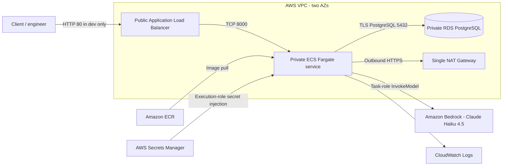
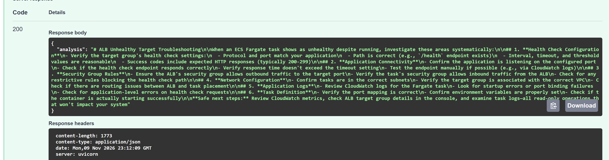

# Cloud-Native Banking API

A portfolio banking API built with FastAPI and deployed to AWS with Terraform. The project demonstrates a private containerized application tier, PostgreSQL persistence, JWT authentication, and a read-only AI operations assistant using Amazon Bedrock.

> **Scope:** This is a development and engineering portfolio project, not a production banking platform. It does not process real funds, provide a complete ledger/payment system, or claim regulatory compliance. Deployment evidence is a dated snapshot, not a statement that AWS resources are currently running.

## What the application demonstrates

- Register and authenticate a user; store an Argon2-capable password hash and issue a 30-minute HS256 JWT.
- Create and list a user's accounts; account ownership is checked for API operations.
- Record a withdrawal against a sufficient balance using a database row lock. Deposits are rejected until a trusted payment source exists.
- Run schema changes explicitly with Alembic rather than migrating automatically during every application startup.
- Check process health separately from PostgreSQL readiness.
- Offer JWT-protected, read-only operational troubleshooting with Amazon Bedrock. The model cannot execute AWS actions.

These are API and engineering demonstrations, not full banking business capabilities. There is no verified end-to-end payment rail, double-entry ledger, deposit funding source, customer onboarding/KYC, or production workload.

## Architecture



The VPC, ECS tasks, and load balancer span two Availability Zones; the development NAT Gateway and RDS instance are single-AZ. The ALB's public HTTP listener is development-only. ECS tasks have no public IP; the database is private.

### Selected deployment evidence

These are genuine project screenshots, reviewed and redacted for publication. They document a historical deployment state; they are not generated mockups or a live AWS status check.





*The prompt-injection test's HTTP 200 status only shows that the endpoint returned a response; it does not prove that the prompt was blocked or that the controls are complete.*

See the [screenshot index](docs/screenshots/README.md) for the architecture illustration, provenance, redaction notes, and additional incident evidence.

## Technology

| Area | Implementation |
| --- | --- |
| Cloud and IaC | AWS, Terraform 1.6+, AWS provider 6.x |
| Runtime | Docker, Amazon ECS Fargate, Amazon ECR |
| API | Python, FastAPI, Uvicorn, Pydantic |
| Data | RDS PostgreSQL, SQLAlchemy, Alembic, Psycopg |
| Identity and secrets | JWT (HS256), `pwdlib` password hashing, AWS Secrets Manager, IAM task roles |
| AI | Amazon Bedrock Runtime, Boto3 Converse API, Claude Haiku 4.5 US inference profile |
| Logs and tests | CloudWatch Logs, Pytest |

## Infrastructure design

Terraform is split into reusable `vpc`, `security`, `iam`, `database`, and `compute` modules. The development deployment uses:

- A VPC with public and private subnets in two Availability Zones, an Internet Gateway, and one shared NAT Gateway.
- An internet-facing ALB routing to private Fargate tasks on **port 8000**.
- An ECS service with desired count two, ECR image scanning on push, and a seven-day CloudWatch log group.
- Private, encrypted RDS PostgreSQL with one-day backup retention, Single-AZ compute, and AWS-managed master credentials.
- Separate ECS execution and application task roles; task secrets and scoped Bedrock invocation permissions are configured in Terraform.
- Security-group references for ALB-to-task port 8000 and task-to-database port 5432.

The two-AZ subnet layout is not equivalent to end-to-end high availability: one NAT Gateway and one database instance are shared dependencies. RDS is configured with `skip_final_snapshot = true`, which is unsuitable for production data without an explicit retention/backup plan.

Only the development deployment has been evidenced. A local `terraform/environments/dev/terraform.tfvars` exists but is ignored and not committed. No tracked staging or production variable files, separate state configuration, environment deployments, or production readiness evidence exist. The AWS provider currently fixes the region and CLI profile in source. Read the [architecture reference](docs/architecture.md) and [engineering tradeoffs](docs/engineering-tradeoffs.md).

## Application and database

The FastAPI application exposes registration/login, account creation/listing, transaction creation, health/readiness, and AI operations routes under `/api`. Database models and the initial Alembic revision define `users`, `accounts`, and `transactions`.

The API uses Argon2-capable password hashing and JWT bearer authentication for account, transaction, and AI operations. The database URL builder supports either a complete `DATABASE_URL` or discrete `DB_*` values and uses SQLAlchemy's `URL.create` for URL-safe credential handling. The deployed container is configured with the public AWS RDS CA bundle at `backend/certs/global-bundle.pem` and TLS certificate verification.

## Read-only AI operations assistant

`POST /api/ops/analyze` accepts a short operational description after JWT verification. Boto3 calls Bedrock Runtime's Converse API using the ECS task role and the configured Claude Haiku 4.5 US inference profile. The intended use is to summarize likely causes and safe investigation steps for issues such as ECS health failures or database connectivity.

Implemented controls include input length limits, checks for selected secret-like patterns, JSON serialization and untrusted-input labeling, separate system instructions, and selected output checks. Provider/output validation errors are returned as controlled HTTP 502 responses and logged. The model receives no AWS tools or infrastructure mutation capability.

These controls are limited: regex checks are not complete DLP, prompt instructions cannot guarantee prompt-injection resistance, and output validation is pattern-based. See [AI operations](docs/ai-operations.md) and [security design](docs/security-design.md).

## Deployment and validation evidence

Evidence and repository history record:

- **October 30, 2026 (Stage 1):** initial infrastructure rollout, ECS/ALB health validation, and two healthy targets; the environment was later torn down while ECR was preserved.
- **November 17, 2026 (Stage 2):** private PostgreSQL deployment, Alembic migration to `d368608d12af`, verified schema/readiness, private-task Bedrock inference, four cloud-hosted AI API status checks, and a Terraform no-change plan after the AI IAM update.
- **November 18, 2026:** a 503/target-draining troubleshooting sequence followed by successful health and readiness HTTP 200 checks.
- **November 20, 2026:** screenshots record ECS startup, Bedrock IAM troubleshooting, and an authenticated AI security-check sequence.

The November 17 project record states that **19 local Pytest tests passed** at that time. The local backend suite also passed during this documentation update: **19 passed**, with one Starlette test-client deprecation warning. Neither result proves cloud IAM, production resilience, or real banking workflows. No AWS commands or deployments were performed as part of this documentation update.

## Troubleshooting and incident response

The evidence includes AWS authentication and IAM permission failures, KMS access denial, ECS startup failure, ALB 503/target draining, PostgreSQL connection/authentication failures, Secrets Manager access denial, Bedrock `InvokeModel` denial, and AI authentication/input validation checks.

The incident index distinguishes confirmed recovery from incomplete investigations. It does not invent customer impact, outage duration, recovery time, or unobserved root causes. See [troubleshooting](docs/troubleshooting.md) and [incident reports](docs/incidents/).

## Engineering tradeoffs and production readiness

Fargate and managed RDS reduce operational burden for a small demonstration; the single NAT and Single-AZ RDS reduce development cost but are availability dependencies. HTTP, mutable image tags, local Terraform state, short backup retention, master-user database credentials, lack of CI/CD/alarms/WAF, and limited AI safety checks are explicit gaps—not production defaults.

The [tradeoff review](docs/engineering-tradeoffs.md) describes alternatives and when they become appropriate. Before any real banking workload, this project would need a threat model and compliance program, TLS at every public boundary, a production data model and payment controls, stronger identity and secret lifecycle, durable/locked state, HA and disaster recovery, monitoring, rate limits, audited deployment automation, and independent testing.

## Repository map

```text
banking-app/
├── backend/
│   ├── app/                 # API routes, services, models, auth, AI validation
│   ├── migrations/          # Alembic schema history
│   ├── tests/               # Pytest suite
│   ├── certs/                # Public RDS CA bundle
│   └── Dockerfile
├── terraform/
│   ├── modules/             # compute, database, IAM, security, VPC
│   └── environments/        # local ignored dev variables only
├── docs/
│   ├── incidents/           # evidence-based incident reports
│   ├── screenshots/evidence/# reviewed publication copies
│   └── ...                  # architecture, AI, security, operations
└── README.md
```

## Documentation

- [Architecture and infrastructure](docs/architecture.md)
- [Engineering tradeoffs](docs/engineering-tradeoffs.md)
- [Security design](docs/security-design.md)
- [AI operations](docs/ai-operations.md)
- [Troubleshooting index](docs/troubleshooting.md)
- [Detailed incident reports](docs/incidents/)
- [Screenshot inventory and evidence](docs/screenshots/README.md)
- [Publication and sensitive-data review](docs/publication-review.md)
- [Backend setup and tests](backend/README.md)

## Local development

Use Python 3.12+, PostgreSQL for application behavior, and Docker Desktop for image builds. From `backend/`, create a virtual environment, install `requirements.txt`, configure a local-only `DATABASE_URL` and `JWT_SECRET_KEY`, then run migrations and the API. Full instructions and placeholder examples are in [backend/README.md](backend/README.md).

Never copy AWS, RDS, JWT, or customer secrets from the deployment into local development, tests, documentation, or screenshots. Terraform and AWS commands can incur cost; review plans and billing before any separate deployment work.

## Future improvements

- Add a production-grade business ledger, payments and reconciliation, idempotency, audit controls, and domain validation.
- Add HTTPS with ACM, rate limiting/WAF, and explicit authentication/session lifecycle improvements.
- Use a restricted database application role instead of RDS master credentials; define tested backup and restore objectives.
- Use Multi-AZ RDS and per-AZ NAT or suitable VPC endpoints where justified by availability/cost requirements.
- Add remote encrypted Terraform state and locking; isolate environment accounts, roles, and state.
- Pin immutable image digests, add CI/CD with short-lived credentials, and gate image/security findings.
- Add CloudWatch metrics/alarms, tracing, ECS scaling, incident runbooks, and tested recovery procedures.
- Expand adversarial AI tests, structured outputs, data minimization, invocation budgets, and model evaluation.
