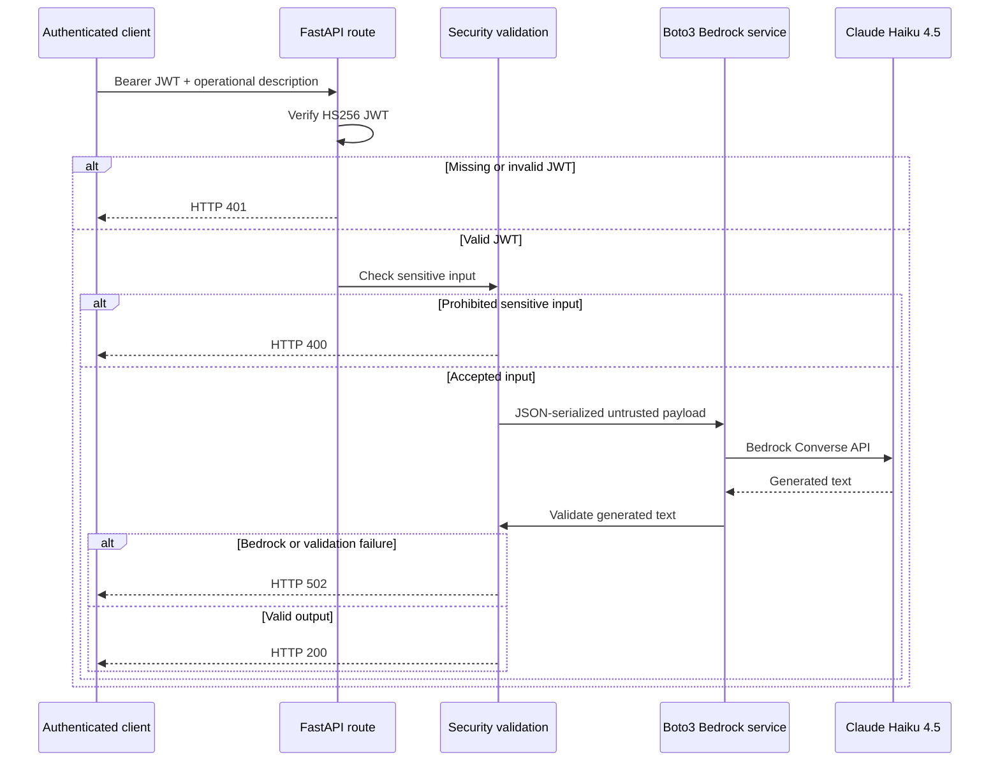

# AI Operations

This document describes the implemented Amazon Bedrock integration, security controls, verified behavior, and current limitations for the Banking API operations assistant.

## Request flow

`POST /api/ops/analyze` is implemented in [ops.py](../backend/app/api/routes/ops.py) and registered under `/api` in [main.py](../backend/app/main.py).



## Bedrock runtime

[bedrock_service.py](../backend/app/services/bedrock_service.py) creates a Boto3 `bedrock-runtime` client in `us-east-1`. Deployed ECS tasks use the application task role; the implementation does not contain AWS access keys.

The Converse call uses inference profile:

```text
us.anthropic.claude-haiku-4-5-20251001-v1:0
```

Runtime configuration:

| Setting | Value |
| --- | --- |
| Connect timeout | 5 seconds |
| Read timeout | 60 seconds |
| Retry attempts | 2 |
| Retry mode | Standard |
| Maximum output tokens | 400 |
| Temperature | 0.2 |

## JWT authentication

[security.py](../backend/app/core/security.py) uses FastAPI bearer authentication:

- Tokens use `HS256`.
- Tokens expire after 30 minutes.
- Verification rejects invalid signatures, malformed tokens, missing or invalid subjects, and expired tokens.
- Missing or invalid authentication returns HTTP 401.

The signing secret is supplied through ECS from Secrets Manager. It is not stored as an application source value.

## Input and prompt-injection defenses

[ai_security.py](../backend/app/core/ai_security.py) rejects descriptions containing AWS access-key patterns, Bearer tokens, or password assignments before calling Bedrock.

[bedrock_service.py](../backend/app/services/bedrock_service.py) also:

1. Serializes the description with `json.dumps` as an `operational_description` field.
2. Sends trusted system instructions separately from the user payload.
3. Labels the JSON as untrusted operational data.
4. Instructs the model not to claim infrastructure actions or request credentials, customer data, or balances.
5. Gives Claude no Bedrock tool or AWS execution capability.

These controls reduce risk but do not guarantee complete resistance to prompt injection. JSON serialization is data separation, not a security boundary.

## Output validation and API errors

Before a response is returned, [ai_security.py](../backend/app/core/ai_security.py) applies sensitive-data checks and blocks explicit claims that CloudTrail was disabled or a database was deleted, dropped, destroyed, or wiped.

[ops.py](../backend/app/api/routes/ops.py) maps failures to controlled responses:

| Condition | HTTP status |
| --- | --- |
| Missing or invalid JWT | 401 |
| Description below 10 or above 1000 characters | 422 |
| Sensitive input pattern | 400 |
| Bedrock Boto3 invocation failure | 502 |
| Generated output fails validation | 502 |

No raw Bedrock provider response or secret is returned to the client.

## IAM permissions

[iam/main.tf](../terraform/modules/iam/main.tf) uses separate ECS roles:

- Execution role: pull ECR images, publish CloudWatch logs, and retrieve the specific database and JWT secrets.
- Application task role: `bedrock:InvokeModel` only for the configured Claude Haiku inference profile and associated foundation-model resources.

The [task definition](../terraform/modules/compute/main.tf) injects secret-backed database credentials and the JWT key. These values are not printed in container environment settings as plain Terraform values.

## Verified live inference

The live Bedrock test used a standalone ECS Fargate task and FastAPI `TestClient`; it exited with code 0 and a live Claude Haiku 4.5 inference was completed.

The cloud-hosted API security test used a synthetic JWT generated inside the container:

| Test | Expected | Actual |
| --- | --- | --- |
| Missing authentication | 401 | 401 |
| Invalid JWT | 401 | 401 |
| Prohibited sensitive input | 400 | 400 |
| Valid authenticated AI request | 200 | 200 |

All four passed. Public login and public authenticated ALB traffic were not tested because HTTPS is not configured.

## Known limitations

- Regex checks are neither complete DLP nor proof against all sensitive data.
- Prompt-based defenses cannot guarantee complete prompt-injection resistance.
- No structured model response schema or confidence score is enforced.
- No WAF, request throttling, AI usage alarms, or automated cloud prompt-injection suite is deployed.
- The public listener is development HTTP; it is not suitable for real credentials or sensitive banking data.
- HTTPS, production monitoring, and automated CI/CD remain future work.

## Source links

- [AI route](../backend/app/api/routes/ops.py)
- [Bedrock service](../backend/app/services/bedrock_service.py)
- [AI security validation](../backend/app/core/ai_security.py)
- [JWT authentication](../backend/app/core/security.py)
- [AI tests](../backend/tests/test_ops.py)
- [Security design](security-design.md)
- [Architecture](architecture.md)
