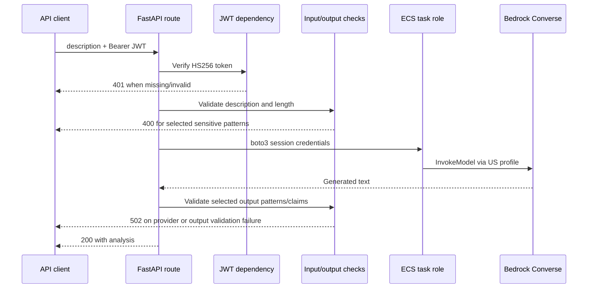
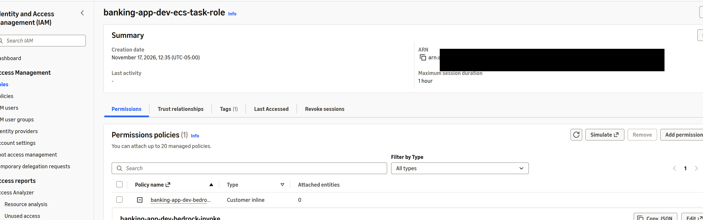

# AI operations assistant

## Purpose and operating boundary

The Banking API includes a JWT-protected, read-only operational analysis endpoint. It can suggest investigation steps for an engineer describing an issue. It does not query AWS telemetry on its own, run commands, or modify cloud resources. No AWS tool/action interface is provided to the model.

This is an advisory portfolio feature, not an incident automation system. Engineers must validate recommendations against authoritative logs/configuration and use approved change procedures.

## Runtime request flow

`POST /api/ops/analyze` is registered by `backend/app/main.py` and implemented in `backend/app/api/routes/ops.py`.



## Bedrock integration

`backend/app/services/bedrock_service.py` creates a Boto3 `bedrock-runtime` client for `us-east-1` and invokes `client.converse(...)` with:

```text
us.anthropic.claude-haiku-4-5-20251001-v1:0
```

This is a US cross-region inference profile. The request configures a 5-second connect timeout, 60-second read timeout, standard retry mode with two maximum attempts, maximum 400 output tokens, and temperature 0.2. ECS uses the task-role credential provider; no AWS access key is embedded in the application configuration. A local developer's AWS profile may be used for local inference if explicitly configured and authorized.

The source-defined IAM task policy grants `bedrock:InvokeModel` to the inference profile and related foundation model resources in supported US regions. It does not grant model listing, general Bedrock administration, or infrastructure modification. Effective access can also depend on service/model availability, account access, region, quotas, and organization policy.



The attached-policy screenshot shows role configuration, not the policy's effective scope; the Terraform policy source is the evidence for the configured action/resource scope.

## Input handling and prompt injection

The Pydantic request requires a description from 10 through 1,000 characters. `check_sensitive_data` rejects selected patterns for AWS access-key IDs, Bearer tokens, and password assignments before any Bedrock call.

The service serializes the description with `json.dumps` in an `operational_description` field, sends trusted system instructions separately, and labels user text as untrusted operational data. The system prompt directs Claude to analyze symptoms and suggest safe read-only steps; not to ask for credentials, customer data, or balances; and not to claim that it changed resources or logging.

JSON encoding and prompt separation reduce accidental instruction mixing but are not security boundaries. A model can still follow malicious or confusing content, and regex checks can miss sensitive data or flag benign text. Do not send customer records, account balances, tokens, credentials, or confidential incident data to this endpoint.

## Output validation and failure handling

Before returning text, `validate_ai_output` applies the same selected sensitive-pattern checks and blocks a small set of explicit claims that the assistant disabled CloudTrail or destroyed a database. This is not a general factuality, safety, or data-loss-prevention guarantee.

| Condition | Implemented behavior |
| --- | --- |
| Missing/invalid/expired JWT | HTTP 401 |
| Description outside request limits | FastAPI/Pydantic HTTP 422 |
| Selected sensitive input pattern | HTTP 400; Bedrock is not called |
| Boto3/Bedrock provider error | Exception logged; controlled HTTP 502 |
| Output rejected by validator | Warning logged; controlled HTTP 502 |
| Accepted response | HTTP 200 JSON with `analysis` |

The route does not return the raw provider exception to clients. Logs still require access control, retention, and data-minimization review; error messages and test prompts should not contain secrets.

## Authentication and workload identity

The AI route depends on `get_current_user_id` in `backend/app/core/security.py`. JWTs use HS256 and expire after 30 minutes. Passwords are hashed using `pwdlib.PasswordHash.recommended()`, which selects the library's recommended password-hashing configuration (Argon2-capable in the deployed dependencies).

The ECS task definition uses separate roles:

- **Execution role:** image pull/log delivery and ECS startup-time retrieval of configured secret values.
- **Application task role:** Bedrock invocation at runtime.

This separation prevents static AWS keys in the app container and avoids giving the model AWS credentials or tool access. It does not itself protect JWTs over the public development HTTP listener.

## Recorded verification

The project record for November 17 reports live inference from a private standalone Fargate task, exit code 0, and a cloud-hosted FastAPI `TestClient` run using a synthetic JWT generated inside the container:

| Check | Expected | Recorded |
| --- | ---: | ---: |
| Missing authentication | 401 | 401 |
| Invalid JWT | 401 | 401 |
| Prohibited sensitive input | 400 | 400 |
| Authenticated AI request | 200 | 200 |

On November 20, a CloudWatch screenshot shows another sequence with missing JWT 401, invalid JWT 401, sensitive data 400, and a prompt-injection test request returning 200. The curated status log does not show the response body. A 200 response means the request was accepted and the model returned text; it does not establish that the injected instructions were rejected or that prompt-injection controls are comprehensive. The image is redacted in the publication copy.

The current local test suite is separate from those historical cloud checks. Public login and authenticated requests through the public ALB were not verified in the recorded deployment because HTTPS was not configured.

## Limitations and recommendations

- Prompt instructions and pattern checks cannot fully prevent prompt injection, secret leakage, hallucinations, unsafe advice, or data exposure.
- No structured response schema, confidence calibration, telemetry query/tool integration, rate limiting, concurrency budget, WAF, or Bedrock usage alarms is configured.
- The feature is not a replacement for incident command, change review, or tested runbooks.
- Enforce HTTPS before sending credentials; minimize/redact submitted incident context and avoid customer data.
- Add rate limits, request/response data handling policy, scoped log access, AI cost alarms, adversarial evaluations, and stronger output policy tests before wider use.
- If adding tools in the future, use deterministic allowlisted operations with human approval, narrow service identities, audit records, idempotency, and independent policy enforcement. Do not grant the model a general-purpose AWS role.

## Implementation references

- [Operations endpoint](../backend/app/api/routes/ops.py)
- [Bedrock client and Converse request](../backend/app/services/bedrock_service.py)
- [Input/output checks](../backend/app/core/ai_security.py)
- [JWT and password hashing](../backend/app/core/security.py)
- [Terraform IAM roles](../terraform/modules/iam/main.tf)
- [ECS task configuration](../terraform/modules/compute/main.tf)
- [AI tests](../backend/tests/test_ops.py)
- [Security design](security-design.md)
- [Incident index](troubleshooting.md)
