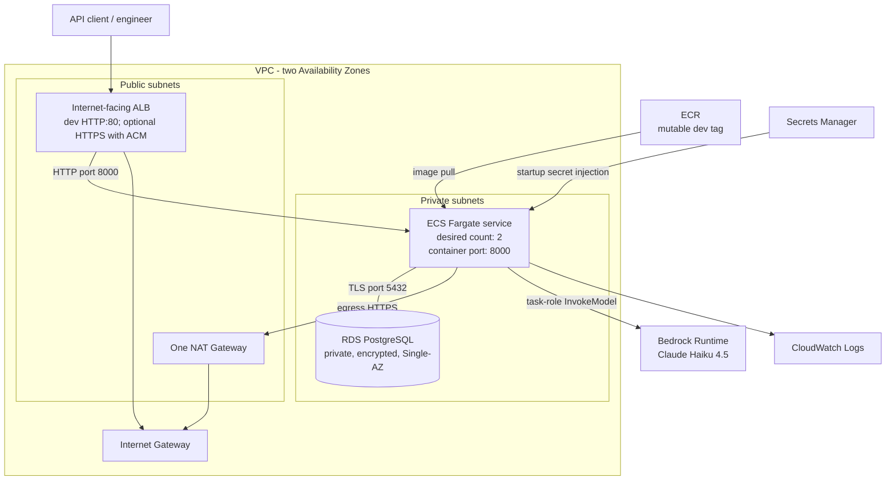

# Architecture and infrastructure reference

## Scope and evidence

This reference describes the Terraform modules and FastAPI implementation in this repository and the development deployment documented in project records/screenshots through November 20, 2026. It is not a claim that the resources remain deployed now. No production/regulatory readiness is claimed.

## Logical architecture

The Application Load Balancer is public; application tasks and RDS are not. ECS tasks use `awsvpc`, private subnets, and `assign_public_ip = false`. The NAT Gateway provides outbound access; it does not carry inbound client traffic.

## Terraform organization

| Module | Responsibility |
| --- | --- |
| `terraform/modules/vpc` | VPC, public/private subnets, Internet Gateway, EIP/NAT Gateway, route tables and associations |
| `terraform/modules/security` | ALB, backend, and database security groups and ingress/egress rules |
| `terraform/modules/iam` | ECS execution/task roles, secret reads, model invocation policy |
| `terraform/modules/database` | RDS PostgreSQL and private DB subnet group |
| `terraform/modules/compute` | ECS cluster/task/service, ECR, CloudWatch log group, ALB/listeners/target group |

The root `terraform/main.tf` composes modules and passes resource outputs as inputs. The database depends on private subnet/security-group outputs; the IAM module receives the database secret ARN; compute receives the role ARNs, network/security-group IDs, database endpoint, and secret ARNs. The explicit `depends_on` on compute keeps role/network setup ahead of service provisioning.

Modules isolate concerns and allow the same component code to be parameterized. They do not alone create environment isolation, reusable state, safe CI/CD, or environment-specific AWS identities.

## Environment configuration and deployment status

| Environment | Repository evidence | Status |
| --- | --- | --- |
| Development | Local ignored `terraform/environments/dev/terraform.tfvars`; deployment records/screenshots for Stage 1 and Stage 2 | Deployed and validated at recorded points; current live state not checked |
| Staging | No tracked configuration or deployment evidence | Prepared only in the sense that variables/modules can be reused; not an implemented environment |
| Production | No tracked configuration or deployment evidence | Not deployed; production requirements are future work |

`terraform/providers.tf` currently hardcodes `us-east-1` and the local profile `banking-terraform-role`. No tracked environment tfvars, remote backend, workspace/account separation, environment promotion, or production pipeline is present. `enable_dev_http_listener` defaults to false, but that does not make an environment production-ready. The development variable file is ignored and must stay local.

## VPC, subnets, routes, and outbound dependencies

The VPC uses DNS support/hostnames and two public and two private subnets, one per configured Availability Zone. Public route tables send `0.0.0.0/0` to an Internet Gateway. Private route tables send default egress through one NAT Gateway in the first public AZ. Public subnet instances can receive public IPv4 addresses; private ECS tasks cannot.

The ALB attaches to both public subnets. ECS tasks and the RDS subnet group use the private subnets. The RDS instance itself is configured `multi_az = false`, so a two-AZ DB subnet group does not make the instance Multi-AZ.

The shared NAT provides task egress to ECR, CloudWatch, Secrets Manager, Bedrock, and other AWS APIs over HTTPS. This creates a single egress dependency and can incur cross-AZ data transfer when tasks in the other AZ use it. VPC endpoints can reduce NAT dependency/cost for supported services, subject to service coverage and endpoint cost.

## Traffic flow and trust boundaries

1. A client reaches the public ALB listener. The development HTTP listener is conditional and public; an HTTPS listener is created only when an ACM ARN is configured.
2. The ALB forwards to IP targets on TCP 8000. Target health checks use `GET /api/health`, HTTP 200, 30-second intervals, 5-second timeout, and configured healthy/unhealthy thresholds of 2/3.
3. ECS task security groups accept port 8000 from the ALB security group, not arbitrary client CIDRs.
4. The application opens PostgreSQL TLS connections to RDS on port 5432. The RDS security group allows ingress from the backend security group only.
5. The task security group permits outbound HTTPS and database traffic. There is no public IP on the task or public route from the database.
6. ECS retrieves container secrets during startup using its execution role. Runtime Bedrock calls use the separate application task role.

The security-group module opens ALB ingress on 443, but an HTTPS listener exists only when a certificate ARN is supplied. The documented development deployment has no configured certificate/listener and exposes HTTP; an open SG rule is not proof of HTTPS.

## ECS, ECR, load balancing, and logs

The compute module defines Fargate with `awsvpc`, 256 CPU units, 512 MiB memory, desired count two, and port 8000. The service uses private subnets, a 60-second health-check grace period, and an ECS deployment circuit breaker with rollback enabled.

ECR has scan-on-push enabled but uses mutable tags; the task definition points at `:dev`. Updating that tag alone does not force a new deployment or pin a running release to an immutable digest. No image-signing or CI/CD gate is configured.

CloudWatch receives container stdout/stderr in `/ecs/<project>-backend`, with seven-day retention. The repository does not configure a full application metrics/alarms/tracing program.

## RDS, migrations, and secrets

The RDS module creates PostgreSQL on gp3 with 20 GB default storage, encryption at rest, `publicly_accessible = false`, Single-AZ deployment, one-day backup retention, and `skip_final_snapshot = true`. AWS manages the master-user password and provides its secret ARN to ECS. **Operator note:** retention was reduced to one day following a development-account restriction; the original restriction/error is not captured. This is a development constraint and cost-conscious disposable profile, not a durable customer-data configuration.

The API uses SQLAlchemy and Alembic. Migrations were executed through standalone ECS tasks in the private network; the application image includes Alembic files. Schema creation is not automatically run on every process start. The application receives connection fields and secret JSON fields through ECS secret injection. The RDS public CA bundle is included at `backend/certs/global-bundle.pem`; in the ECS deployment `verify-full` uses this CA bundle.

## IAM roles

| Identity | Intended responsibility | Current permissions evidenced in source |
| --- | --- | --- |
| ECS execution role | Pull image, initialize task, publish logs, inject configured secrets | AWS ECS task execution policy plus `GetSecretValue` for the specified DB and JWT secret ARNs |
| ECS application task role | AWS API calls made by running code | `bedrock:InvokeModel` scoped to the configured Haiku US inference profile and associated regional foundation-model resources |
| Terraform deployer | Provision and update infrastructure | Local named profile; policy is external to this repository |
| Image publisher | Push image from workstation | Separate deployment-time ECR identity; not the ECS application role |

The application has no autonomous infrastructure mutation capability. Verify effective permission boundaries, SCPs, KMS key policies, and external policies separately; a Terraform statement alone does not establish effective authorization.

## Availability and cost posture

Two public/private subnet pairs and two desired Fargate tasks provide a placement/failover option across AZs, and the ALB can route around unhealthy targets. They do not guarantee capacity or eliminate shared failures. One NAT Gateway and a Single-AZ RDS instance remain availability dependencies. No current service state, SLO, failover test, backup restore test, or recovery objective is asserted.

Primary recurring cost drivers are NAT hours/data processing, public ALB hours/capacity, Fargate vCPU/memory/runtime, RDS instance/storage/backups, public IPv4, ECR storage, Secrets Manager, CloudWatch ingestion/retention, and Bedrock token usage. A single NAT and small Single-AZ RDS lower development cost but trade away resilience. See [engineering tradeoffs](engineering-tradeoffs.md).

## Readiness gaps

- No HTTPS certificate/listener in the evidenced development environment.
- No Multi-AZ RDS, tested point-in-time recovery, final snapshot policy, or documented RPO/RTO.
- One shared NAT Gateway and local Terraform state without remote locking.
- Mutable `dev` image reference; no automated build/release pipeline.
- RDS master-user credentials injected into the app rather than a restricted application DB role.
- Seven-day logs without demonstrated alarms, metrics, tracing, WAF, or rate limiting.
- No tracked staging/production configuration or verified production deployment.

## Related documentation

- [Security design](security-design.md)
- [AI operations](ai-operations.md)
- [Tradeoffs](engineering-tradeoffs.md)
- [Troubleshooting](troubleshooting.md)
- [Screenshot evidence](screenshots/README.md)
