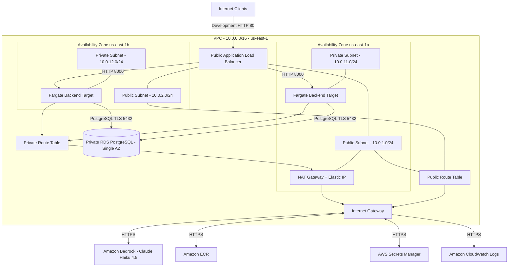

# Architecture and Terraform Reference

## Overview

This document describes the cloud architecture successfully deployed and validated on November 17, 2026, during Stage 2 of the Cloud-Native Banking Application project.

The architecture combines modular Terraform infrastructure, private containerized services, encrypted relational storage, centralized secrets management, and generative AI through Amazon Bedrock.

The environment is designed for development and portfolio demonstration rather than production financial workloads.

## AWS Architecture



The diagram represents logical connectivity and intended workload distribution. ECS manages task placement across the available private subnets; Terraform does not assign a fixed task to each Availability Zone.

The RDS subnet group spans both private subnets, but the database instance itself is Single-AZ.

## 1. Networking Architecture

### Virtual Private Cloud

| Configuration | Value |
| --- | --- |
| Region | us-east-1 |
| VPC CIDR | 10.0.0.0/16 |
| Availability Zones | us-east-1a, us-east-1b |
| DNS resolution | Enabled |
| Public subnets | 2 |
| Private subnets | 2 |
| NAT Gateways | 1 |
| Internet Gateways | 1 |

### Subnet Allocation

| Subnet | CIDR | Availability Zone |
| --- | --- | --- |
| Public A | 10.0.1.0/24 | us-east-1a |
| Public B | 10.0.2.0/24 | us-east-1b |
| Private A | 10.0.11.0/24 | us-east-1a |
| Private B | 10.0.12.0/24 | us-east-1b |

Public subnets support internet-facing infrastructure, while private subnets host backend services and database resources.

### Routing

Public subnet routing:

```text
0.0.0.0/0 → Internet Gateway
```

Private subnet routing:

```text
0.0.0.0/0 → NAT Gateway
```

The NAT Gateway resides in the first public subnet and provides outbound connectivity for both private subnets.

Private ECS tasks use outbound HTTPS to access services including:

- Amazon ECR.
- Amazon CloudWatch.
- AWS Secrets Manager.
- Amazon Bedrock.

Inbound application traffic reaches ECS through the Application Load Balancer, not through the NAT Gateway.

### Networking Trade-Off

A single NAT Gateway reduces development infrastructure costs but introduces a shared egress dependency and potential cross-AZ data transfer charges.

A production architecture should evaluate redundant NAT Gateways and applicable AWS VPC endpoints.

## 2. Application Load Balancer

The internet-facing Application Load Balancer distributes incoming application traffic across registered ECS task IP addresses.

| Configuration | Value |
| --- | --- |
| Listener | HTTP 80 |
| Target type | IP |
| Backend port | 8000 |
| Health check | /api/health |
| Health matcher | HTTP 200 |
| Health check interval | 30 seconds |
| Health check timeout | 5 seconds |
| Healthy threshold | 2 |
| Unhealthy threshold | 3 |

The ALB spans both public subnets.

An optional HTTPS listener exists in the compute module, but the development deployment does not provide an ACM certificate.

Public HTTP is intended only for development connectivity and non-sensitive health validation.

Authentication credentials and financial information must not be transmitted over this development HTTP listener.

## 3. ECS Fargate Compute

The backend runs as an ECS Fargate service.

| Configuration | Value |
| --- | --- |
| Launch type | Fargate |
| Network mode | awsvpc |
| Desired task count | 2 |
| CPU per task | 256 CPU units |
| Memory per task | 512 MiB |
| Container port | 8000 |
