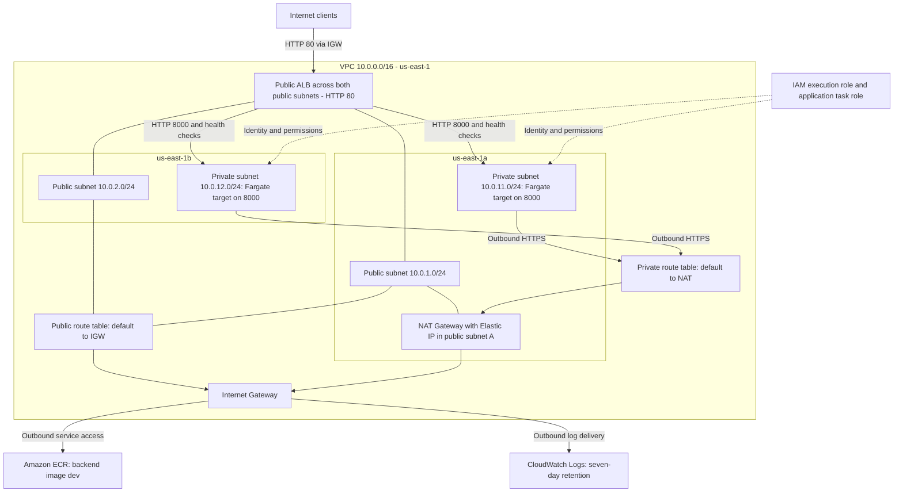

# Architecture and Terraform reference

This reference describes inspected source and owner-verified October 30, 2026 deployment results. AWS was not queried. The diagram shows the Stage 1 configuration deployed before teardown, not a current resource inventory. The owner confirmed teardown completed with empty Terraform state; only the preserved ECR repository/image was verified ACTIVE afterward. The observed targets span two AZs; Terraform configures two desired tasks and two private subnets, not a fixed task per subnet.



Subnet links indicate placement/association; arrows show logical traffic. IAM dotted links represent permissions, not routing. ECR pulls and log delivery use public endpoints via NAT; no VPC endpoints are configured. ALB ingress does not traverse NAT. RDS is absent because it was disabled in Stage 1. ECR remains declared as a Terraform resource even though it was removed from state for preservation; it must be imported before a future normal apply.

## Module inventory

| Module | Resources and behavior |
| --- | --- |
| [vpc](../terraform/modules/vpc/main.tf) | DNS-enabled VPC; two public/two private subnets; IGW; one EIP/NAT in `us-east-1a`; two route tables with default routes; four associations |
| [security](../terraform/modules/security/main.tf) | ALB/backend/database security groups; four active ingress rules including development HTTP; three egress rules |
| [iam](../terraform/modules/iam/main.tf) | Two roles trusting `ecs-tasks.amazonaws.com`; execution role attached to `AmazonECSTaskExecutionRolePolicy`; no application-task policy attachment |
| [compute](../terraform/modules/compute/main.tf) | ECR, ECS cluster/task definition/service, log group, ALB, IP target group, HTTP listener; optional HTTPS inactive |
| [database](../terraform/modules/database/main.tf) | Root count disables it; when enabled, creates DB subnet group and private encrypted PostgreSQL RDS with AWS-managed master password |

The reported **34 additions** are a historical apply result, not a state inventory or computed total from current source. Existing resources and conditional resources can affect an apply count. No fresh plan or state audit was performed to reconcile that number.

## Root variables

[Variables](../terraform/variables.tf) require project name, VPC CIDR, both subnet maps, and database name. Both enable flags default to false. The inspected local dev tfvars file contains the following non-secret settings. A fresh checkout can use these to recreate `terraform/environments/dev/terraform.tfvars` relative to the Banking App project root:

```hcl
project_name = "banking-app-dev"
vpc_cidr = "10.0.0.0/16"
public_subnets = {
  "us-east-1a" = "10.0.1.0/24"
  "us-east-1b" = "10.0.2.0/24"
}
private_subnets = {
  "us-east-1a" = "10.0.11.0/24"
  "us-east-1b" = "10.0.12.0/24"
}
db_name = "bankingdb"
enable_dev_http_listener = true
enable_database = false
```

`db_name` is still required when RDS is disabled. NAT placement explicitly indexes `us-east-1a`; changing AZs requires code review. Region and profile are fixed in [providers.tf](../terraform/providers.tf), not root variables.

Compute/security default `backend_port` to 8000. Compute defaults `acm_certificate_arn` to null; the root exposes no certificate variable or forwarding argument. Database defaults are `db.t3.micro`, 20 GiB gp3, username `bankadmin`; root passes only database name and networking. The optional instance has seven-day backups, encryption, `multi_az = false`, and `skip_final_snapshot = true`.

## Health, runtime, and outputs

The ALB checks HTTP `/api/health` for 200 every 30 seconds, with five-second timeout, healthy threshold two and unhealthy threshold three. ECS grace period is 60 seconds. There is no task-definition container health check. Static health JSON does not establish database readiness.

The Dockerfile contains two base-image stages; the final stage runs Uvicorn on `0.0.0.0:8000` as UID 10001. Dependencies list FastAPI and Uvicorn without version pins. Image tag `dev` is mutable. These are review items, not code changes made by this documentation work.

[Root outputs](../terraform/outputs.tf) expose VPC/subnet IDs and nullable database values. Compute outputs are not implemented, so ALB DNS, ECS details, and ECR URI require an authorized Console lookup. No S3 backend is declared; local state is used by default. State, backups, saved plans, and plan text should remain private.

HTTPS, authentication, database integration, CI/CD, remote state, autoscaling, and alerting remain future work. The single NAT is an egress availability/cost tradeoff. Execution and application roles are separate from the operator's deployment role and do not grant a workstation permission to publish images.
