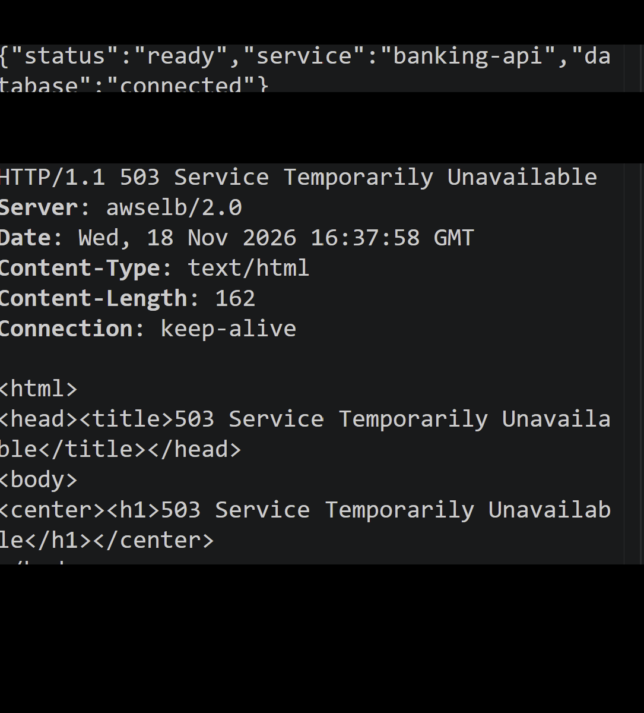
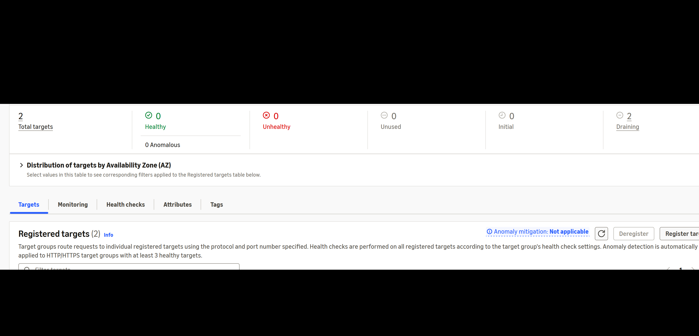
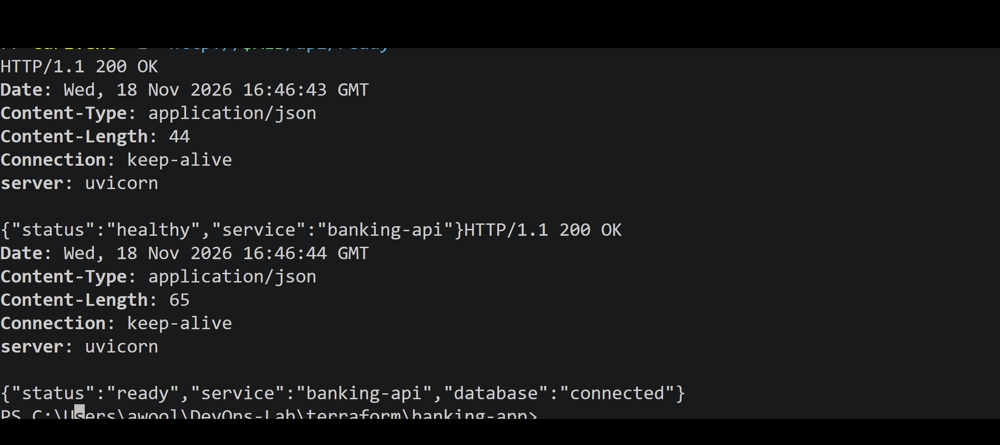

# ALB HTTP 503 and draining targets

**Classification:** Controlled development deployment/troubleshooting event. **Outcome:** Health and database readiness were later observed returning HTTP 200; the initiating change is unknown.

## Incident overview

The November 18 screenshot sequence shows a previously healthy baseline, an ALB 503 response, two targets in draining state with zero healthy targets, and later successful API health/readiness responses.

## Symptoms and observed errors

- `GET /api/health` returned `HTTP/1.1 503 Service Temporarily Unavailable` from the ALB.
- The target group screenshot shows two registered targets, zero healthy and two draining; both private targets were on port 8000 in different AZs.
- A later `curl` sequence returned HTTP 200 for `/api/health` and `/api/ready`; readiness JSON included `database: connected`.

No measured service-impact duration, request volume, or real banking customer impact is shown.

## Potential banking business impact

If this API were serving users, an ALB 503 could make account/authentication/transaction endpoints unavailable. The screenshot does not establish that real users or financial transactions were affected.

## Investigation process

The evidence supports checking target registration/health reason codes, ECS desired/running count and service events, task stop reasons, deployment state, health-check path/port, and CloudWatch startup logs. Validate `/api/health` and `/api/ready` separately after targets register.

## Root cause

The target group observed no healthy target capacity while both targets were draining. The evidence does not show why deregistration began or which configuration/change initiated it; do not label it an application crash, bad health-check path, or specific deployment as a proven root cause.

## Corrective action

The evidence shows the service returned to successful health/readiness responses later in the sequence. It does not identify a specific operator change. Do not state that a particular rollback, scale-up, or target-group edit caused recovery.

## Why the correction worked

An ALB can serve requests once registered targets return to a healthy state and the application responds successfully. The precise recovery mechanism remains unknown.

## Recovery validation

At 16:46:43–16:46:44 GMT on November 18, the recorded commands returned HTTP 200 for both endpoints. The readiness body reported the database connected. This is a point-in-time recovery check, not an availability SLO or proof of continued service.

## Preventive recommendations

- Alert on ECS running/desired count, deployment circuit-breaker events, target health, and elevated ALB 5xx.
- Capture target health reason codes and correlate them with ECS events and CloudWatch task logs.
- Use a deliberate deployment drain/grace-period policy and test rollback.
- Keep liveness and dependency readiness semantics explicit; avoid masking a DB outage as application health.
- Add a post-deployment check for health, readiness, and an authorized application workflow.

## Before/after evidence

## Related documentation

- [ALB target group and ECS service](../../terraform/modules/compute/main.tf)
- [Health and readiness routes](../../backend/app/api/routes/health.py)
- [Architecture](../architecture.md)
