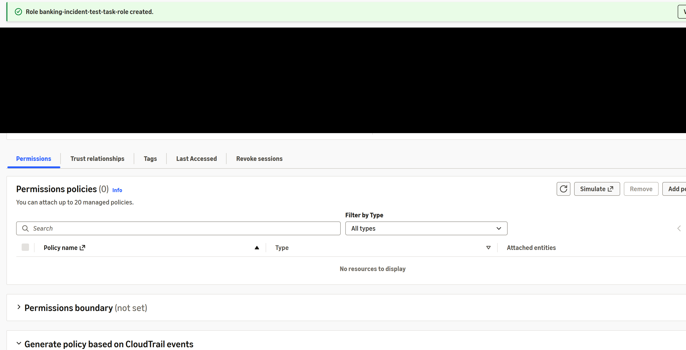
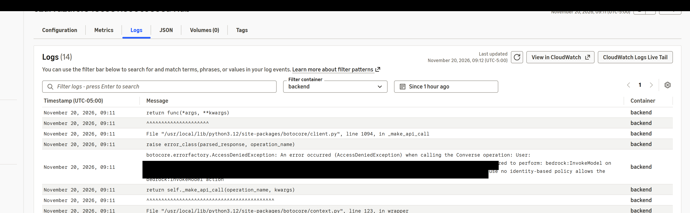
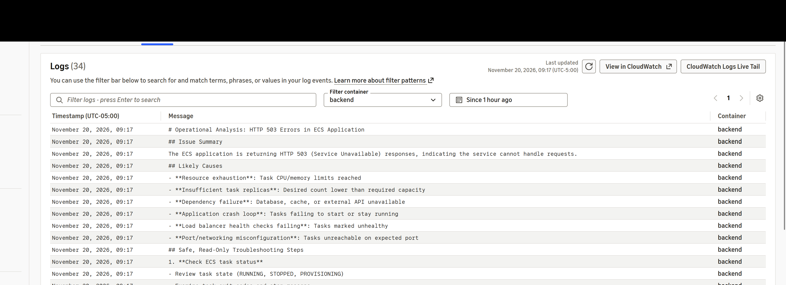
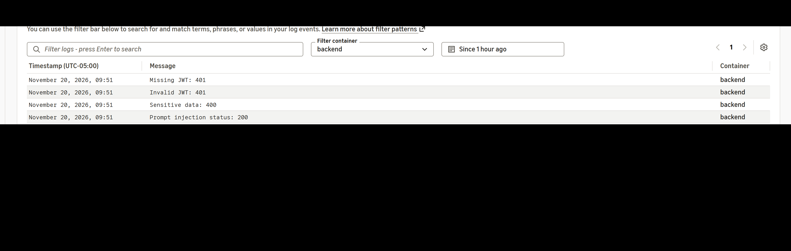

# Bedrock invocation permission failure

**Classification:** Development IAM troubleshooting. **Outcome:** Later successful operational analysis and authenticated API checks provide recovery evidence; current deployment state is not asserted.

## 1. Incident overview

On November 20, screenshots show a test ECS application task role with no attached permissions, a Bedrock runtime access-denied sequence, and later operational-analysis output plus AI API validation results.

## 2. Symptoms and observed error

The test task-role screenshot shows zero permission policies. A CloudWatch log records `AccessDeniedException` for `bedrock:InvokeModel`. Later CloudWatch output contains a generated analysis response, and an API test screenshot records a successful request.

## 3. Potential banking business impact

The AI support endpoint can return a controlled service error if the workload role cannot invoke the configured model. This does not by itself block core banking API routes. No customer impact is evidenced.

## 4. Investigation process

Verify the role attached to the ECS task definition, caller identity for the running task, denied action/resource, inference-profile/model resource ARNs and regions, account model access, and policy layers. Do not repair by granting `bedrock:*` or administrator access.

## 5. Root cause

The isolated test role had no permissions and the CloudWatch log records a Bedrock runtime access denial. This is consistent with missing `bedrock:InvokeModel` authorization for the selected inference profile/resources.

## 6. Corrective action

**Operator note:** Bedrock invocation permissions belong on the ECS application task role. Terraform configures scoped `bedrock:InvokeModel` on that role for the US inference profile and associated regional foundation-model resources. The exact live policy update event for the isolated test role is not included.

## 7. Why the correction worked

Bedrock Runtime authorizes the API call against the task's effective identity and model/inference-profile resources. A scoped allow for the required invocation operation permits the application request when all other account/model controls also allow it.

## 8. Recovery validation

Later CloudWatch output contains an operational analysis at 09:17 on November 20. At 09:51, a private-task validation screenshot records missing JWT 401, invalid JWT 401, sensitive input 400, and a prompt-injection test request 200. The curated status screenshot does not show the response body, so the 200 does not establish that the injected instruction was rejected. These demonstrate later successful application/Bedrock behavior for the recorded requests, not complete security or current service state.

## 9. Preventive recommendations

- Keep Bedrock invocation on the application task role and secrets/image/log permissions on the execution role.
- Pin the inference profile and resource ARNs in reviewed IaC; account for cross-region profile destinations.
- Test from the same ECS task identity used by the service.
- Alert on provider errors and budget/limit inference usage.
- Keep AI failures controlled and avoid returning raw provider details.

## 10. Before/after evidence

## Related documentation

- [IAM task policy](../../terraform/modules/iam/main.tf)
- [Bedrock client](../../backend/app/services/bedrock_service.py)
- [AI operations](../ai-operations.md)
- [Troubleshooting index](../troubleshooting.md)
