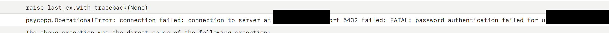
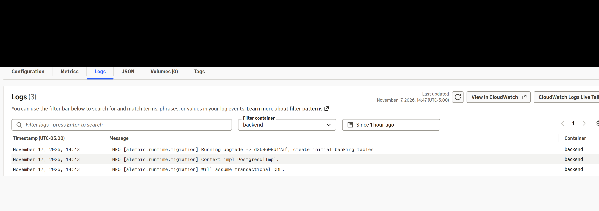
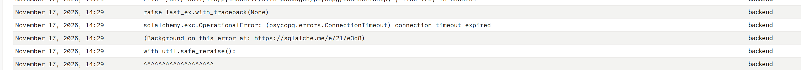

# PostgreSQL connectivity and Alembic migration failures

This report keeps distinct database symptoms separate. Successful migration evidence does not prove that every earlier authentication/network error had the same cause.

## Incident A: PostgreSQL authentication rejected the migration connection

### 1. Incident overview

An Alembic-related PostgreSQL log screenshot records an authentication failure for the database user during a development migration sequence.

### 2. Symptoms and observed error

The visible line reports `FATAL: password authentication failed for user "bankadmin"` while connecting to a private 10.x address on port 5432. The actual password was not shown in the publishable evidence.

### 3. Potential banking business impact

A migration or application connection failure can block schema deployment and database-backed API operations. No customer impact or data loss is evidenced.

### 4. Investigation process

Confirm the intended secret ARN/version, ECS execution role access, injected username/password mapping, DB hostname/name, and the migration task's network. Avoid printing the URL or secret. Inspect URL construction with a password containing URL-reserved characters using safe unit tests.

### 5. Root cause

The database rejected the credentials supplied for `bankadmin`. The evidence does not distinguish an incorrect/stale password from URL encoding, secret-version mismatch, or another credential assembly error. The often-cited “SQLAlchemy URL password masking” root cause is not verified.

### 6. Corrective action

A later screenshot is named as a corrected migration image push, and subsequent screenshots show an Alembic revision applied and the head revision recorded. The precise credential correction/build change and correlation to the same task are not preserved.

### 7. Why the correction worked

The later migration evidence shows that a subsequent task could connect and run the revision. It does not establish which credential/configuration change fixed the earlier failure.

### 8. Recovery validation

Screenshots record the initial migration revision `d368608d12af` running and later `d368608d12af (head)`; database tables were also reported verified. This validates the recorded migration outcome, not the exact earlier fix.

### 9. Preventive recommendations

- Use `URL.create` or equivalent structured URL construction; do not interpolate or log a raw password-bearing URL.
- Make ECS secret version and migration task definition explicit during deployment.
- Verify connectivity with an approved private task before schema changes.
- Keep application DB roles least-privileged and separate from the RDS master account.
- Maintain migration backups and a tested rollback/recovery procedure.

### 10. Associated evidence

## Incident B: Migration task connection timeout

### 1. Incident overview

A CloudWatch task screenshot records a database connection timeout during a private migration attempt.

### 2. Symptoms and observed error

The visible log reports SQLAlchemy/Psycopg `ConnectionTimeout` and `connection timeout expired`. This differs from a PostgreSQL password rejection.

### 3. Potential banking business impact

A timeout can delay schema deployment and leave a release waiting on database readiness. No real user or data impact is evidenced.

### 4. Investigation process

Check that the task is in the intended VPC/private subnets, route and network ACL behavior, backend security-group egress, DB security-group ingress from the task security group on 5432, endpoint/port, RDS state, and task logs. A timeout is not proof of a specific security-group rule.

### 5. Root cause

Not established. The timeout indicates the connection was not completed; the screenshot does not isolate routing, security groups, endpoint resolution, RDS state, or another network cause.

### 6. Corrective action

Subsequent screenshots show a later migration task completing and its revision at head. No specific network change is tied to the earlier timeout in the evidence.

### 7. Why the correction worked

The later task's migration logs establish that database connectivity was eventually available to that task. They do not identify the earlier failure mechanism.

### 8. Recovery validation

Later migration and schema-revision evidence exists. The exact same task/configuration was not demonstrated, so this incident's cause is unresolved even though migration success was later recorded.

### 9. Preventive recommendations

- Capture task ENI/subnets/security-group IDs privately and correlate them with RDS ingress.
- Test TCP reachability and database readiness from the same private network.
- Include bounded connection timeouts and useful non-secret diagnostics.
- Separate network timeout, TLS trust, and authentication failures in runbooks.

### 10. Associated evidence

## Related implementation

- [SQLAlchemy URL/TLS setup](../../backend/app/db/database.py)
- [Alembic environment](../../backend/migrations/env.py)
- [Initial schema revision](../../backend/migrations/versions/d368608d12af_create_initial_banking_tables.py)
- [RDS and security groups](../../terraform/modules/database/main.tf)
- [Incident index](README.md)
