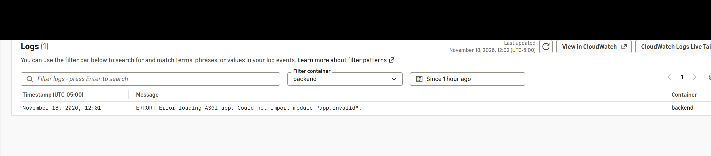
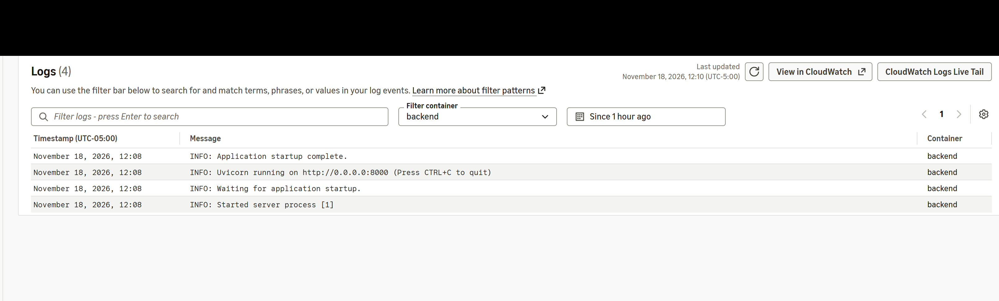

# ECS container startup failure

**Classification:** Development deployment failure. **Outcome:** The import failure and a later successful process startup are recorded; the corrective change and service-wide readiness are not.

## Incident overview

The November 18 CloudWatch sequence includes an ECS container startup failure and a later application startup log. The screenshots do not prove that the same task definition or deployment produced both states.

## Symptoms and observed errors

The failure log reports: `ERROR: Error loading ASGI app. Could not import module "app.invalid".` A later log records `Application startup complete` and Uvicorn listening on `0.0.0.0:8000`.

## Potential banking business impact

A failed essential container can prevent ECS tasks from becoming healthy and reduce or eliminate API capacity. No customer impact, outage duration, or real transaction impact is recorded.

## Investigation process

Check ECS task stopped reason and container exit code, then inspect CloudWatch startup logs. Verify the image/tag/digest, command/entrypoint, module import path, environment variables/secrets, port binding (`0.0.0.0:8000`), health path, and task CPU/memory. Correlate timestamps with the service deployment.

## Root cause

The configured ASGI module name in the failing task was `app.invalid`, which could not be imported. The evidence supports an invalid application import target as the immediate cause of that startup failure. It does not show how that value entered the task configuration.

## Corrective action

The later startup log shows the application starting successfully, but the exact image, task-definition, or command change is not captured. Do not claim a specific correction.

## Why the correction worked

An importable ASGI target is required for Uvicorn to load the application. The later startup log demonstrates a process could start; the evidence does not establish which change supplied the valid target.

## Recovery validation

The later CloudWatch screenshot records `Application startup complete` and Uvicorn running on port 8000. This verifies process startup only; no correlated ALB target-health or `/api/ready` result is shown for this incident.

## Preventive recommendations

- Keep health checks aligned with the actual application port/path and include a deliberate grace period.
- Test the production container command and environment in CI before deployment.
- Emit actionable startup errors without logging secrets.
- Record image digest, task definition revision, stop reason, and target-health status during a rollout.
- Use deployment circuit-breaker rollback and validate both health and readiness.

## Before/after evidence

## Related documentation

- [ECS task and service](../../terraform/modules/compute/main.tf)
- [Backend Dockerfile](../../backend/Dockerfile)
- [Troubleshooting index](../troubleshooting.md)
