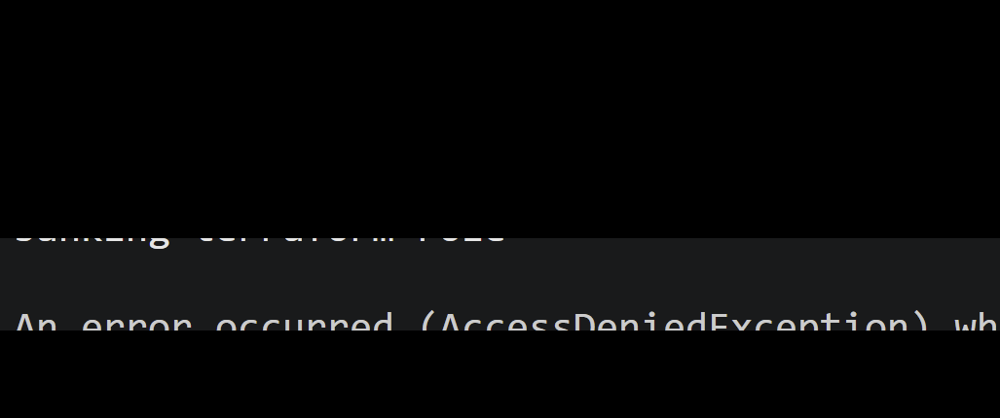
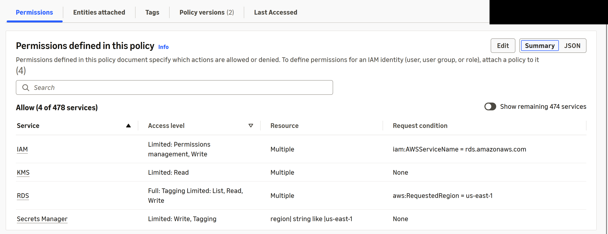
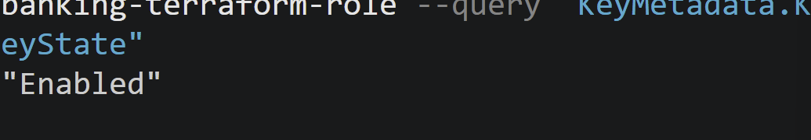

# KMS key metadata permission failure

**Classification:** Development operator-permission troubleshooting. **Outcome:** The key-state query later reported `Enabled`; end-to-end RDS recovery is not established by that result alone.

## Incident overview

The source sequence includes a KMS `DescribeKey` access denial, a later deployment-role policy summary with limited KMS read, and a key-state query.

## Symptoms and observed error

The redacted terminal excerpt records an access-denied `DescribeKey` operation. Key/account/request identifiers are removed. A screenshot labeled for an inaccessible RDS KMS key is an exact duplicate of a Terraform plan and is not independent KMS evidence.

## Potential banking business impact

Missing metadata access can block an authorized operator from inspecting encrypted-resource configuration or delay provisioning/recovery. No database outage, data loss, or customer impact is established.

## Investigation process

Identify the caller, exact key and region, denied action, IAM policy, key policy, permission boundary, and organization controls. Distinguish metadata access from cryptographic use; do not grant decrypt or key-administration privileges without a demonstrated requirement.

## Root cause

**Operator note:** the deployment identity was missing `kms:DescribeKey`. The error screenshot is consistent with that action being denied, but does not show the full effective policy set.

## Corrective action

**Operator note:** the correction added scoped `kms:DescribeKey` permission rather than unrestricted KMS access. A later policy summary shows limited KMS read; the exact statement/resource scope is not visible in that capture and is not presented as independently verified.

## Why the correction worked

`DescribeKey` enables key metadata inspection. It does not grant decrypt, encryption, key administration, or broad cryptographic use. The key policy and other policy layers still affect the effective authorization result.

## Recovery validation

The later key-state query reports `Enabled`. This establishes that the metadata query succeeded and the key state was enabled at that point. It does not prove that the RDS creation/connection path completed or that the key was used successfully by RDS.

## Preventive recommendations

- Grant only the action/resource required by the denied operation.
- Review IAM policy, key policy, boundary, and organization controls together.
- Validate with a scoped query and then verify the dependent RDS operation separately.
- Keep account, key, and request identifiers out of published screenshots.

## Associated evidence

## Related documentation

- [Terraform IAM module](../../terraform/modules/iam/main.tf)
- [Security design](../security-design.md)
- [Incident index](README.md)
