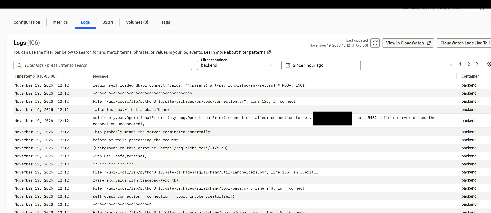
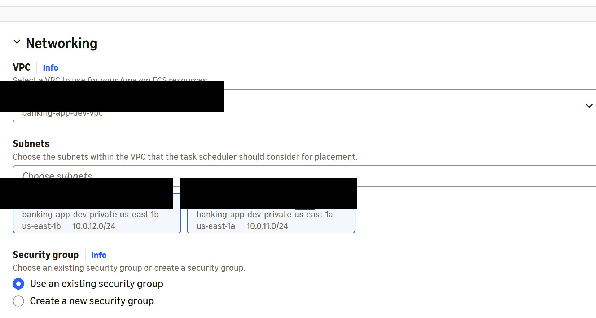
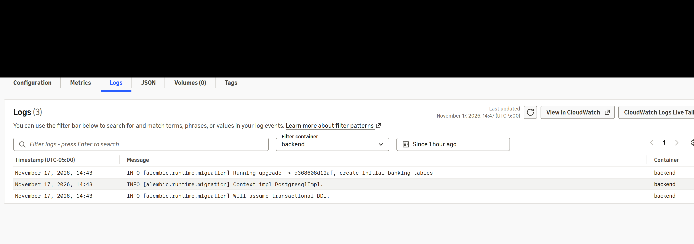

# RDS connectivity and security-group troubleshooting

This report keeps two database-network observations distinct: a November 19 application connection-close log, and an operator-reported standalone migration-task timeout caused by a missing backend security group.

## Incident A: application connection closed unexpectedly

**Incident overview:** CloudWatch evidence dated November 19 shows the backend failing while opening a PostgreSQL connection.

**Symptoms and observed error:** The log reports that the server at a private `10.0.12.x` address on port 5432 closed the connection unexpectedly. This differs from a password-authentication failure and does not by itself prove a security-group issue.

**Potential banking business impact:** Database connection failures can block login, account reads, or transaction processing. No customer data, real transaction, outage duration, or financial impact is evidenced.

**Investigation process:** Check RDS status/events, task ENI/VPC/route, backend and database security groups, DNS, TLS/CA configuration, PostgreSQL logs, and exact task/timestamp correlation. Separate network filtering from a server-side process termination, TLS failure, and bad credentials.

**Root cause:** Not established. The follow-up original filename suggests an SG correction, but the available log does not prove that the SG caused the server to close the connection.

**Corrective action:** No specific rule delta is recorded for this event. The separate screenshot labeled “connectivity restored” contains insufficient same-task readiness evidence and is not published as proof of recovery.

**Why the correction may have worked:** Allowing the backend security group to reach the database security group on TCP 5432 is consistent with the Terraform segmentation and can resolve a blocked network path. It would not by itself resolve a database process failure, credential rejection, or TLS trust error.

**Recovery validation:** No `/api/ready` or successful SQL query is tied to the same November 19 task/deployment. This event is **not marked fully recovered**.

**Preventive recommendations:** Use backend-SG-to-database-SG ingress on 5432; correlate task and RDS logs; validate readiness from the same release; and record the precise rule change and validation.

**Associated evidence:**



## Incident B: standalone migration task omitted the backend security group

**Incident overview:** A standalone migration task timed out connecting to PostgreSQL. This is separate from the November 19 connection-close event above.

**Symptoms and observed error:** The task log reports `ConnectionTimeout` and `connection timeout expired`.

**Potential banking business impact:** A network timeout can block a schema release or delay recovery. No real user, transaction, or data impact is evidenced.

**Investigation process:** Compare the migration task's VPC, selected private subnets, ENI, and backend security group with RDS ingress on TCP 5432. Check route tables, DNS, RDS status, and task logs. Useful read-only commands:

```powershell
aws ecs describe-tasks --cluster <cluster> --tasks <task-arn>
aws ec2 describe-security-groups --group-ids <backend-sg-id> <database-sg-id>
aws rds describe-db-instances --db-instance-identifier <db-identifier>
```

**Root cause:** **Operator note:** the migration task was launched without the intended backend security group. The task was relaunched with the correct group. The private-network screenshot shows subnet selection but does not show the chosen SG; this root cause is therefore attributed to the operator note.

**Corrective action:** The task was relaunched with the backend security group, and the migration succeeded according to the operator note and later migration log.

**Why the correction worked:** The RDS security group permits PostgreSQL traffic from the backend security group on TCP 5432. Attaching that group restores the intended path without opening the database to public CIDRs.

**Recovery validation:** The subsequent Alembic task log records a revision upgrade. It supports later migration success but does not show the SG selection itself. It is not evidence that the separate November 19 connection-close event was fixed.

**Preventive recommendations:** Review the standalone task network configuration before launch; explicitly select private subnets and the backend SG; keep the DB ingress source restricted to that SG; and verify migration head/readiness after the task completes.

**Associated evidence:**





## Related documentation

- [Security-group module](../../terraform/modules/security/main.tf)
- [RDS module](../../terraform/modules/database/main.tf)
- [Database TLS implementation](../../backend/app/db/database.py)
- [Database authentication and migration report](database-connectivity-and-migrations.md)
- [Troubleshooting index](../troubleshooting.md)
