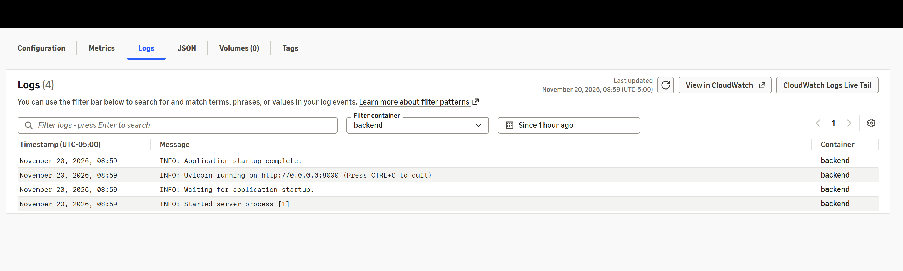

# ECS Secrets Manager access denial

**Classification:** Development task-startup permission check. **Outcome:** The denial is evidenced; later application startup is not correlated to the same test role/task.

## 1. Incident overview

The screenshot intake contains an ECS Secrets Manager access-denied image followed by a screenshot labeled as access restored. The later CloudWatch view shows Uvicorn startup complete.

## 2. Symptoms and observed error

The screenshot records `secretsmanager:GetSecretValue` denied while ECS attempted startup-time secret retrieval under a test execution role. Secret, account, task, and request identifiers are removed from the publication derivative.

## 3. Potential banking business impact

If ECS cannot retrieve required database/JWT secrets, tasks may fail initialization or the application may be unable to authenticate/connect to its database. No user impact is evidenced.

## 4. Investigation process

Identify whether ECS secret injection failed under the **execution role** (not the application task role); verify the exact secret ARN, execution-role trust, `GetSecretValue`, optional customer-managed KMS decrypt/key policy, region, and secret JSON key names. Review stopped-task reason and startup logs without exposing secret values.

## 5. Root cause

The captured error states that the test execution role had no identity-based policy allowing the requested secret read. **Operator note:** ECS startup-time secret retrieval belongs on the execution role, not the application task role. The repository's Terraform execution-role policy grants `GetSecretValue` on the configured database and JWT secret ARNs. Any KMS dependency or live policy update for the isolated test role is not captured.

## 6. Corrective action

The repository configures scoped `secretsmanager:GetSecretValue` grants on the execution role for configured DB/JWT secret ARNs. The exact live policy change applied to the test role is not evidenced, so this is not reported as a confirmed correction to that test.

## 7. Why the correction may have worked

ECS uses the execution role to retrieve task-definition secrets before the container starts. A narrowly scoped secret read on that role can allow initialization; a task-role policy is not a substitute.

## 8. Recovery validation

A later screenshot shows the application startup complete at 08:59 on November 20. It does not show the role update, secret retrieval event, same task identity, or a successful `/api/ready` response. Recovery is **not confirmed for the denied test role/task**.

## 9. Preventive recommendations

- Document role ownership: execution role for startup injection; task role for runtime AWS API calls.
- Scope secret reads to the exact secret ARN and review KMS key policy when applicable.
- Validate secret JSON keys and rotation/version behavior without printing values.
- Capture ECS stopped reason and confirm readiness from the same release after repair.
- Never publish screenshots with secret ARNs/account IDs unless redacted.

## 10. Associated evidence

The corresponding originals remain unmodified in the ignored intake directory.

## Related documentation

- [IAM module](../../terraform/modules/iam/main.tf)
- [ECS task definition](../../terraform/modules/compute/main.tf)
- [Architecture](../architecture.md)
- [Incident index](README.md)
