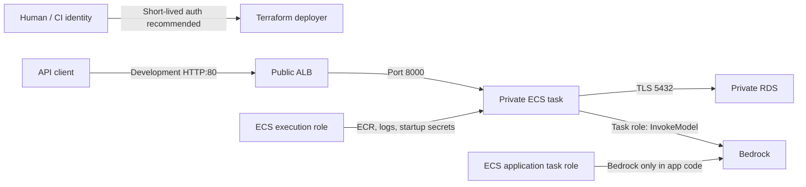

# Security design and verification

## Security scope

This is a development portfolio application, not a production bank or a regulated/compliant service. It has no verified real-money payment rail, full ledger, production identity lifecycle, or independent security assessment. Controls below describe source configuration and dated validation, not a guarantee of security.

## Identity and trust boundaries

The public listener is an internet boundary; the service and database are private network boundaries; AWS API access is an IAM boundary; application registration/JWT checks are an API boundary. Screenshots of individual controls do not establish end-to-end authorization or safety.

## Deployment identity and Terraform

Terraform's provider currently selects local profile `banking-terraform-role` in `us-east-1`. The deployment workflow/history documents MFA-backed temporary credentials; the policy attached to that operator is external to this repository. A profile name alone does not establish its effective principal or permissions.

Use approved short-lived federation/MFA credentials, verify the intended account and role before planning, and keep tokens outside source, command output, screenshots, and shared logs. Current local Terraform state is not remotely encrypted/locked by repository configuration. No CI identity, account isolation, or staging/production deployment is evidenced.

## ECS role separation

| Role | Source-configured responsibility |
| --- | --- |
| ECS execution role | AWS ECS task execution policy, image pull/log delivery, and `secretsmanager:GetSecretValue` for the supplied database and JWT secret ARNs |
| ECS application task role | `bedrock:InvokeModel` scoped to the Claude Haiku US inference profile and associated regional foundation model resources |
| Terraform deployer | Provision infrastructure using the named local profile; exact effective policy is not tracked |
| Workstation image publisher | Separate identity for pushing ECR images; no static publisher key is configured in the app |

ECS uses task-role credentials rather than static AWS keys in the application. The AI model itself is not granted an AWS role, tool, or resource mutation function. Verify IAM permission boundaries, resource policies, KMS policies, SCPs, and regional model access in addition to the Terraform policy document.

## Network and data protection

- ALB ingress is public on development HTTP port 80 when enabled; the security-group module also permits 443. An HTTPS listener is conditional on an ACM certificate ARN and is not evidenced in the development deployment.
- The ALB security group can send TCP 8000 to the backend security group. The task has no public IP.
- The backend security group can send PostgreSQL 5432 to the database security group; the database accepts ingress only from the backend security group. RDS is not publicly accessible.
- ECS egress allows HTTPS through a shared NAT Gateway for AWS APIs. This is outbound connectivity, not an inbound application path.
- RDS storage is encrypted at rest; the database is Single-AZ with one-day backup retention, and Terraform configures `skip_final_snapshot = true`.
- ECS receives database and JWT secret values from Secrets Manager at startup. RDS manages the master password, but the application currently receives that master-user credential instead of a separately restricted application user.
- The app uses `verify-full` with `backend/certs/global-bundle.pem` when configured. ECS sets this certificate path. `database.py` falls back to `sslmode=require` if no CA path is supplied; this fallback does not verify the server identity.

The CA bundle is a public AWS trust bundle and must remain in the repository. It is not a private key.

## API authentication and passwords

`backend/app/core/security.py` requires `JWT_SECRET_KEY` at import/startup, creates HS256 JWTs with a 30-minute expiration, and rejects invalid signatures/subjects/expiry. Account, transaction, and AI routes depend on bearer authentication. Password hashes use `pwdlib.PasswordHash.recommended()`; the configured dependency supports Argon2-capable hashing.

No evidence establishes JWT key rotation, revocation lists, MFA for application users, HTTPS transport, or a production session lifecycle. An HTTP bearer token is exposed to network observers unless transported over TLS; therefore the development HTTP listener must not carry real credentials or sensitive financial data.

## Container and supply chain

The backend Dockerfile runs as UID 10001, uses port 8000, and includes the RDS CA bundle. ECR scan-on-push is enabled. The task definition points at mutable `:dev`, and no image signing, digest pinning, vulnerability gate, or CI/CD release control is configured.

## AI data handling

The AI endpoint checks authentication and input length before Bedrock. Input checks match selected AWS access key, bearer-token, and password-assignment patterns. The service JSON-serializes operational text, separates the system prompt, and labels the user content untrusted. Output validation checks the same small set of sensitive patterns and certain explicit claims about disabling CloudTrail or deleting a database.

These are defense-in-depth checks, not complete DLP or prompt-injection prevention. They may miss secrets or unsafe paraphrases and may reject benign text. Do not send customer records, balances, credentials, JWTs, or confidential incident details. The assistant has no tool call or AWS mutation path.

## Verification status

| Control or check | Status | Evidence/limitation |
| --- | --- | --- |
| Private ECS and private RDS | Implemented; deployment evidence recorded | No current live AWS check in this documentation task |
| RDS storage encryption | Configured in Terraform | Single-AZ and one-day backup retention |
| RDS TLS identity verification | Configured for ECS | Local fallback is `sslmode=require` without CA path |
| Secrets Manager-backed DB/JWT values | Configured in task definition | Master DB secret used by app; rotation not verified |
| Execution/task role separation | Implemented in Terraform | Effective permissions also depend on external AWS policy layers |
| Scoped Bedrock invocation | Implemented in task-role policy | Model/provider availability and quota remain dependencies |
| JWT and password hashing | Implemented in source | No public authenticated TLS workflow verified |
| AI input/output validation | Implemented in source | Pattern/prompt checks are incomplete by design |
| Missing JWT / invalid JWT / sensitive input / valid AI request | Recorded cloud results 401/401/400/200 | Synthetic JWT generated inside a private Fargate test task |
| November 20 prompt-injection test | Recorded request returned 200; curated status log does not include the response body | One prompt case is not a resistance guarantee |
| HTTPS | Not configured in recorded development deployment | ACM ARN/listener required |
| Multi-AZ database, tested restore, WAF, alarms, CI/CD | Not evidenced | Future work |

## Threat considerations

| Threat | Existing mitigation | Residual risk |
| --- | --- | --- |
| Public access to database/tasks | Private subnets, no ECS public IP, security-group references | Misconfiguration, compromised application identity, shared NAT dependency |
| Credential interception | Secrets Manager, private DB TLS | Public ALB HTTP; JWT key rotation not evidenced |
| Password compromise | Password hashing | No MFA/account lockout/rate limiting evidence |
| Unauthorized API use | JWT dependency on protected routes | No revocation, rate limits, or verified TLS path |
| Secret in AI prompt | Selected regex patterns and JSON payload | Pattern gaps, paraphrase, false negatives, confidential context leakage |
| Prompt injection | Separate system prompt, untrusted-data framing, read-only model role | Model behavior is probabilistic; controls do not fully prevent injection |
| Unsafe model response | Limited output checks; no action tools | Novel claims/hallucinations can pass; human verification required |
| Unauthorized AWS invocation | Scoped task-role permission | IAM/resource-policy mistakes, quota/cost abuse |
| Data loss | RDS backups | One-day retention, Single-AZ, no final snapshot, restore not evidenced |
| Malicious/outdated image | ECR scan-on-push | Mutable tag, no digest pin or release gate |

## Production-oriented improvements

Configure HTTPS and reject/redirect HTTP before authentication; separate the app database user from RDS master; define secret rotation and incident handling; introduce remote encrypted/locked Terraform state; use immutable image digests and audited CI with short-lived roles; add rate limiting, WAF, alarms, tracing, AI quotas, and log minimization; choose Multi-AZ/backup/restore objectives from business requirements; and conduct independent threat modeling and compliance review before any financial use.

## Source references

- [IAM](../terraform/modules/iam/main.tf)
- [Security groups](../terraform/modules/security/main.tf)
- [ECS task/service](../terraform/modules/compute/main.tf)
- [RDS](../terraform/modules/database/main.tf)
- [JWT/password hashing](../backend/app/core/security.py)
- [Database TLS and URL construction](../backend/app/db/database.py)
- [AI validation](../backend/app/core/ai_security.py)
- [AI endpoint](../backend/app/api/routes/ops.py)
- [AI service](../backend/app/services/bedrock_service.py)
- [Dockerfile](../backend/Dockerfile)
- [Troubleshooting index](troubleshooting.md)
