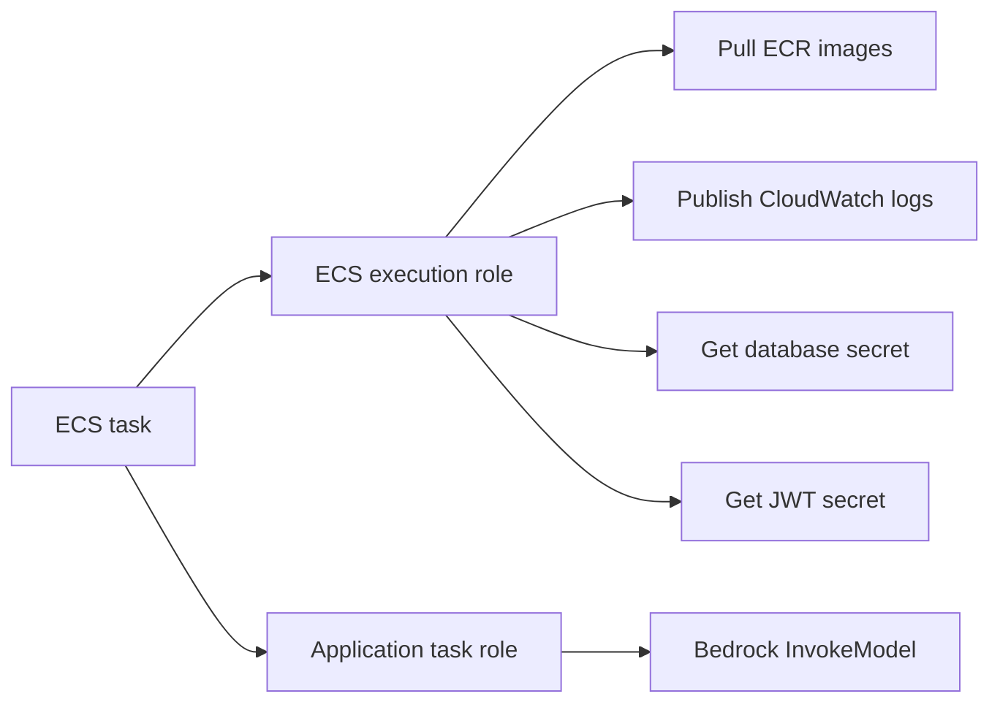
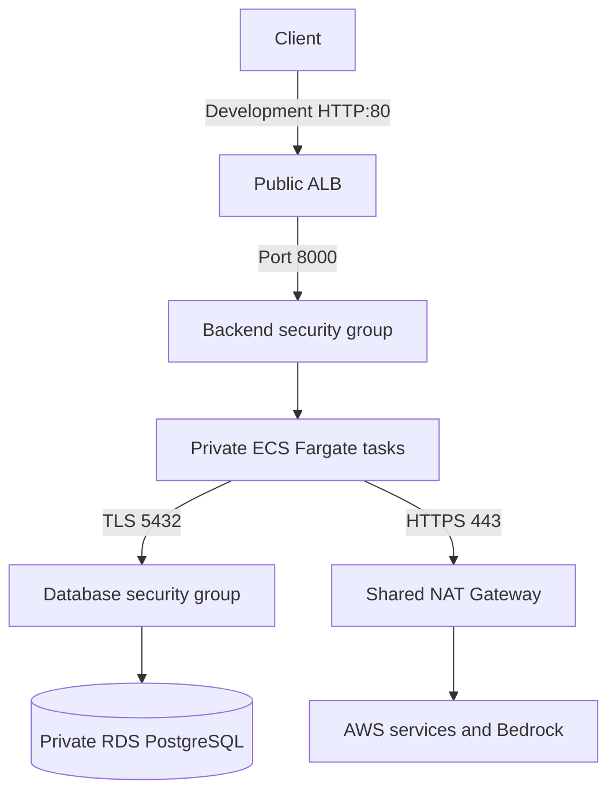

# Security design

This document describes controls implemented in source and Terraform and separates them from verified testing and future improvements.

## Security context

This is a development and portfolio environment, not a production bank platform. Controls are not claimed to provide regulatory compliance or complete resistance to prompt injection.

## Deployment identity

Terraform was operated by the deployer using MFA-backed temporary AWS credentials and an approved named deployment identity. Temporary credentials must be renewed when sessions expire. The deployment workflow also distinguishes the Terraform identity from the workstation ECR publisher identity.

Recommended practice remains MFA, short-lived credentials, least-privilege deployment policy, CloudTrail auditing, and no credentials in source or screenshots.

## IAM role separation

[iam/main.tf](../terraform/modules/iam/main.tf) defines separate ECS execution and application task roles:

| Role | Implemented permissions |
| --- | --- |
| Execution role | ECS managed execution policy; database and JWT `secretsmanager:GetSecretValue` on specific secret ARNs |
| Application task role | `bedrock:InvokeModel` for the Claude Haiku US inference profile and associated US foundation-model resources |
| Workstation publisher | Separate push-time ECR permissions; not granted to the ECS task |

The Bedrock policy is model-scoped and does not grant broad AWS administration.

## Secrets and credentials

RDS uses `manage_master_user_password=true` in [database/main.tf](../terraform/modules/database/main.tf). AWS manages the master secret in Secrets Manager and Terraform passes the secret ARN to ECS.

The ECS task injects:

- `DB_USER` and `DB_PASSWORD` from the RDS master secret.
- `JWT_SECRET_KEY` from the configured JWT secret ARN.
- `DB_HOST`, `DB_PORT`, `DB_NAME`, and the local RDS CA bundle path.

The JWT signing key has not been claimed or confirmed as rotated. Local tests use synthetic placeholder secrets.

## Private networking

[security/main.tf](../terraform/modules/security/main.tf) implements reference-based security groups:

| Source | Destination | Control |
| --- | --- | --- |
| Internet | ALB | HTTP port 80 for development; optional HTTPS 443 only with a configured certificate |
| ALB | ECS | Port 8000 only |
| ECS | RDS | PostgreSQL port 5432 only |
| ECS | Internet via NAT | HTTPS port 443 for AWS APIs |

ECS tasks have `assign_public_ip=false`. RDS has `publicly_accessible=false`.

## RDS encryption and TLS

[database/main.tf](../terraform/modules/database/main.tf) configures:

- `storage_encrypted=true`
- Private RDS subnet group
- No public accessibility
- Single-AZ deployment
- One-day backup retention
- Backend security-group-only database ingress

The application database URL uses `verify-full` and `sslrootcert=/app/certs/global-bundle.pem` when the certificate path is configured. [database.py](../backend/app/db/database.py) falls back to `sslmode=require` if no certificate path is supplied.

The public AWS RDS CA bundle is intentionally retained at [global-bundle.pem](../backend/certs/global-bundle.pem).

## Container and registry controls

[Dockerfile](../backend/Dockerfile) uses the non-root `appuser` UID 10001 and exposes port 8000. The image contains:

- FastAPI application code
- Alembic configuration and migrations
- Public RDS CA bundle
- Python runtime dependencies

[compute/main.tf](../terraform/modules/compute/main.tf) creates an ECR repository with push-time image scanning. ECS runs two Fargate tasks in private subnets.

Current limitations:

- ECR image tags are mutable.
- No image digest pinning or automated build/signature policy is configured.
- ECR scan findings are not automatically gated in CI/CD.

## Authentication and password security

[security.py](../backend/app/core/security.py) implements:

- JWT creation with 30-minute expiration
- `HS256` verification
- Subject and expiration validation
- HTTP 401 for missing or invalid tokens
- Argon2 password hashing through `pwdlib.PasswordHash.recommended()`

JWTs protect application endpoints; HTTPS is required for safe public transport.

## AI security controls

[bedrock_service.py](../backend/app/services/bedrock_service.py) uses Boto3 Bedrock Runtime with a 5-second connect timeout, 60-second read timeout, standard retries, and the Claude Haiku 4.5 US inference profile.

Defenses in [ai_security.py](../backend/app/core/ai_security.py) and [ops.py](../backend/app/api/routes/ops.py):

- Bearer authentication before AI processing
- Description length limits
- Input checks for AWS access keys, Bearer tokens, and password assignments
- Trusted system prompt separated from JSON-serialized untrusted input
- Read-only role instructions and prompt-injection handling
- Output checks for sensitive patterns
- Rejection of prohibited infrastructure-action claims
- HTTP 502 for provider or output-validation failures
- No Claude tool or AWS execution capability

These controls are defense-in-depth. Regex patterns can miss or falsely classify text, and prompt defenses cannot provide complete prompt-injection prevention.

## Verified cloud security tests

All tests below ran in a standalone ECS Fargate task using FastAPI `TestClient`, live Bedrock inference, and a synthetic JWT generated inside the container:

| Test | Result |
| --- | --- |
| Missing authentication | HTTP 401 |
| Invalid JWT | HTTP 401 |
| Prohibited sensitive input | HTTP 400 |
| Valid authenticated request | HTTP 200 |

Public login and authenticated ALB traffic were not tested because HTTPS is not configured.

## Security control table

| Control | Status | Verification |
| --- | --- | --- |
| Private ECS networking | Implemented | ECS private subnets, no public IP |
| Private RDS | Implemented | Public access disabled, SG reference |
| RDS encryption at rest | Implemented | `storage_encrypted=true` |
| RDS TLS verification | Implemented | AWS CA bundle and `verify-full` |
| Secrets Manager database credentials | Implemented | ECS secret injection |
| Secrets Manager JWT signing secret | Implemented | ECS execution role secret injection |
| Execution/task role separation | Implemented | Separate IAM roles |
| Scoped Bedrock permissions | Implemented | Model and inference-profile resource ARNs |
| Argon2 password hashing | Implemented | `pwdlib` recommended hasher |
| JWT HS256 and 30-minute expiry | Implemented | Source and security tests |
| AI input/output validation | Implemented | Cloud and local tests |
| ECR scan on push | Implemented | ECR repository setting |
| Non-root container | Implemented | UID 10001 |
| RDS backup retention | Implemented | One day |
| MFA-backed deployment identity | Verified for deployment | Temporary session evidence |
| HTTPS | Not implemented | HTTP listener is development-only |
| Multi-AZ RDS | Future improvement | Single-AZ only |
| Production monitoring | Future improvement | Basic ECS logs only |
| Automated CI/CD | Future improvement | No deployment pipeline |

## Threat modeling

| Threat | Implemented mitigation | Remaining exposure |
| --- | --- | --- |
| Public database access | Private subnet and reference security groups | Master credential compromise, misconfiguration |
| Token forgery or replay | HS256 verification and 30-minute expiry | No HTTPS listener; key compromise; no revocation list |
| ECS credential exposure | Separate task role and no static AWS keys | IAM misconfiguration |
| Secrets disclosure | Secrets Manager and ECS injection | Secret exposure in logs or memory |
| Database credential on the network | PostgreSQL TLS verification | Trusts AWS CA bundle; ALB remains HTTP |
| Sensitive AI input | Regex validation | Pattern gaps and paraphrases |
| Prompt injection | System prompt and untrusted-data labeling | Not fully resistant |
| Unsafe AI output | Output pattern validation | Novel unsafe output or trusted-text false positives |
| Bedrock misuse | Scoped task-role policy | Quota abuse or cost exposure |
| Container compromise | Non-root runtime and private networking | Broad task-role dependencies and mutable image tags |

## Known limitations and future improvements

- Configure ACM certificates and HTTPS listener; redirect or disable public HTTP.
- Deploy Multi-AZ RDS and test failover.
- Replace master database credentials with a restricted application database role.
- Enforce secret rotation and key lifecycle procedures.
- Use remote Terraform state with encryption and locking.
- Add redundant NAT or suitable VPC endpoints.
- Pin immutable image digests and gate ECR findings.
- Add CI/CD with short-lived deployment credentials.
- Add ECS autoscaling, CloudWatch alarms, metrics, tracing, and retention controls.
- Add AWS WAF, AI endpoint rate limits, concurrency limits, and usage budgets.
- Expand adversarial prompt-injection tests and structured response validation.
- Document incident response and key/credential compromise procedures.
- Complete full banking workflow testing before any production claim.

## Source links

- [Architecture](architecture.md)
- [AI operations](ai-operations.md)
- [Network and security groups](../terraform/modules/security/main.tf)
- [Compute and ECS roles](../terraform/modules/compute/main.tf)
- [IAM policies](../terraform/modules/iam/main.tf)
- [RDS configuration](../terraform/modules/database/main.tf)
- [JWT implementation](../backend/app/core/security.py)
- [Database TLS implementation](../backend/app/db/database.py)
- [AI route](../backend/app/api/routes/ops.py)
- [AI security validation](../backend/app/core/ai_security.py)
